# Mars to Go

**Keep a crew alive on Mars with real NASA data. No choice is free.**

[Português](README.pt-BR.md) · NASA Space Apps Challenge 2026 · Challenge: *Build a Junior Astronaut Mission Trainer* ([official text](docs/CHALLENGE_STATEMENT.md))

[](https://github.com/Rafaelafeijo/mars-to-go/actions/workflows/ci.yml)
[](https://github.com/Rafaelafeijo/mars-to-go/actions/workflows/e2e.yml)
[](https://github.com/Rafaelafeijo/mars-to-go/actions/workflows/pages.yml)

## ▶ Play now: **https://rafaelafeijo.github.io/mars-to-go/**

Free, in the browser, no download, no account. Best on a computer; fully playable on phones and tablets. English by default, Portuguese one tap away (top bar).

- Jump straight to mission 2: https://rafaelafeijo.github.io/mars-to-go/?mission=2
- 29-second demo video: https://youtu.be/zaAPhmpyvIg

[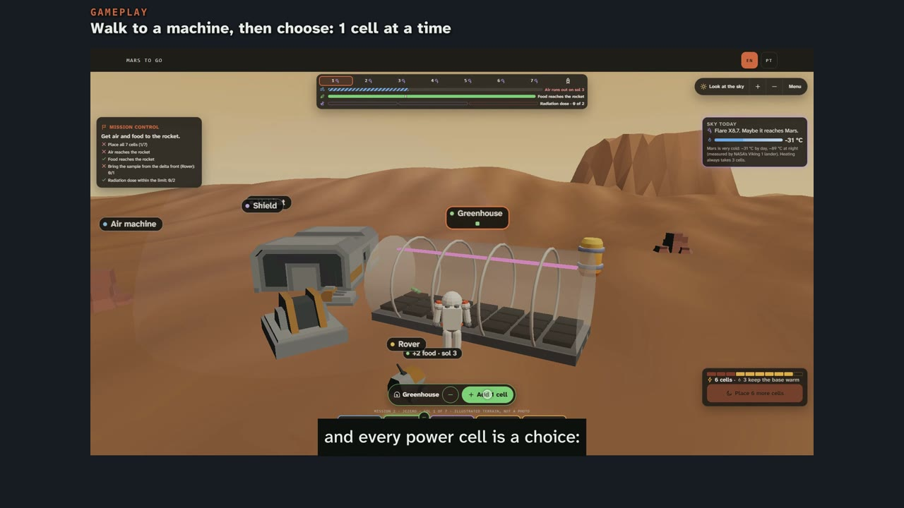](https://youtu.be/zaAPhmpyvIg)

---

## In one paragraph

Mars to Go is a free browser game where kids ages 7–12 run a crewed base in Jezero Crater, Mars, for seven sols (a sol is a Mars day). Every sol they get a fixed budget of power cells to split between air, food, a radiation shield, a rover and an antenna to Earth. There is never enough for everything, so every choice shows its cost: a cell in the shield tonight is air missing tomorrow, and food planted today only arrives two sols later. The solar storms are real: each event is a NASA DONKI record from May 2024, and mission 2 ends with the storm Curiosity measured on the surface of Mars on May 20, 2024. After every night, the game explains the math and shows a real NASA fact with a real photo. Every number shows its source and date.

**The value, for a child:** you learn by deciding, not by answering a quiz. Survival in deep space is a budget of power, air, food and radiation under real solar weather, and real data, with its source and date, is how astronauts and engineers decide.

| | |
| --- | --- |
| **For** | Kids 7–12 (Cadet level for the youngest; Commander for older kids, siblings and parents) |
| **Where** | Any modern browser: computer, phone or tablet |
| **Languages** | English and Portuguese, complete in both |
| **Data** | NASA DONKI (archived and live), Curiosity RAD, Mars Fact Sheet, MOXIE, Veggie, BVAD, NASA-STD-3001, NASA photos |
| **Team** | Rochette, a mother-and-son team (named after a rock on Mars that Perseverance sampled) |
| **Cost to play** | Zero. No accounts, no ads, no analytics, no personal data |

## Contents

1. [Why we built it](#1-why-we-built-it)
2. [How it plays](#2-how-it-plays)
3. [How the cell logic works](#3-how-the-cell-logic-works)
4. [How we built the missions](#4-how-we-built-the-missions)
5. [Real NASA data, with a trail](#5-real-nasa-data-with-a-trail)
6. [The five judging criteria, with evidence](#6-the-five-judging-criteria-with-evidence)
7. [Tested with a real child](#7-tested-with-a-real-child)
8. [How we worked: method and timeline](#8-how-we-worked-method-and-timeline)
9. [Architecture and infrastructure](#9-architecture-and-infrastructure)
10. [Quality: tests, security, performance](#10-quality-tests-security-performance)
11. [Accessibility, languages and privacy](#11-accessibility-languages-and-privacy)
12. [Run it locally](#12-run-it-locally)
13. [Use of AI](#13-use-of-ai)
14. [Credits and licenses](#14-credits-and-licenses)
15. [Limitations and next steps](#15-limitations-and-next-steps)

---

## 1. Why we built it

### A mother, a son, and a question

Team Rochette is a mother and her 8-year-old son. He wants to learn everything about space and, maybe, to become an astronaut one day. She is a software developer making her first game. We wanted something he could *play* that would teach him what the posters and videos do not: that every day on another world is a set of hard choices, and that the people who make those choices use real data.

He was the first tester of every version (section 7). No name, image or voice of him appears anywhere in this project.

### The gap the challenge describes is real

The challenge says kids usually see a mission's outcome, never the trade-offs behind it, and that space content is either too abstract or too technical. Research on educational games agrees:

- **Most "educational" apps are digital worksheets.** Hirsh-Pasek et al. (2015) found that most apps in the market "are simply digital worksheets, games, and puzzles that have been reproduced in an e-format without any explicit consideration of how children learn." ([*Psychological Science in the Public Interest* 16(1):3–34](https://doi.org/10.1177/1529100615569721))
- **58% of top-downloaded children's learning apps are lower-quality.** In a content analysis of 124 apps, 72 (58%) scored as lower-quality, and 73% scored low on active learning, where the lowest score means the app "drills skills, and feels like an online workbook." (Meyer et al., 2021, [*Journal of Children and Media*](https://doi.org/10.1080/17482798.2021.1882516))
- **Quizzes dominate; simulations are rare.** A mapping of 176 studies on mobile educational games (2019–2024) found quiz mechanics in 40.91% of studies and simulation in 10.80% (Sales & Oliveira, 2025, [*Journal on Interactive Systems*](https://doi.org/10.5753/jis.2025.5947), Table 4). A 2025 review of 91 children's games found quizzes in 41.8% and simulations in 19.8% (Damenu et al., [arXiv:2508.17414](https://arxiv.org/abs/2508.17414), preprint).

Mars to Go is a simulation, not a quiz: the child learns by deciding, then sees the consequence and the reason.

### In Brazil, where we live

- **The curriculum asks for exactly this.** Brazil's national curriculum (BNCC) asks 9th-graders to "select arguments about the viability of human survival outside Earth, based on the conditions necessary for life, the characteristics of the planets and the distances and times involved in interplanetary travel" (skill EF09CI16, quoted from [Nova Escola](https://novaescola.org.br/bncc/conteudo/70/saiba-como-ensinar-o-eixo-tematico-terra-e-universo-em-ciencias) and BNCC copies; our translation).
- **But astronomy teaching is described as "simplistic".** A 2022 review describes "an ensino simplista [simplistic teaching] with different failures in the different educational spheres," and cites a study where only 10% of biology teacher-training courses in Paraná offered basic astronomy (Buffon, Neves & Pereira, 2022, [*Ciência & Educação* 28:e22006](https://doi.org/10.1590/1516-731320220006)). Textbooks are "often the only source the teacher consults" (Langhi & Nardi, [*Caderno Brasileiro de Ensino de Física* 24(1)](https://periodicos.ufsc.br/index.php/fisica/article/view/6055)).
- **And interest is huge.** 1,386,046 students from 13,053 schools took part in the 2023 Brazilian Astronomy and Astronautics Olympiad (OBA), with 74,694 teachers ([OBA 2023 report](https://sistema.oba.org.br/sisglob/sisglob_arquivos/2026/Relatorio%20da%2026%20OBA%20-%202023-compactado.pdf)).

### And worldwide

In a 2019 Harris Poll for the LEGO Group of 3,000 children aged 8–12 in the US, UK and China, **86% said they were interested in space exploration and 90% wanted to learn more** ([LEGO Group, July 2019](https://www.lego.com/en-id/aboutus/news/2019/july/lego-group-kicks-off-global-program-to-inspire-the-next-generation-of-space-explorers-as-nasa-celebrates-50-years-of-moon-landing); an online poll commissioned by a toy company). Our son is one of many.

---

## 2. How it plays

| Computer | Phone |
| --- | --- |
| 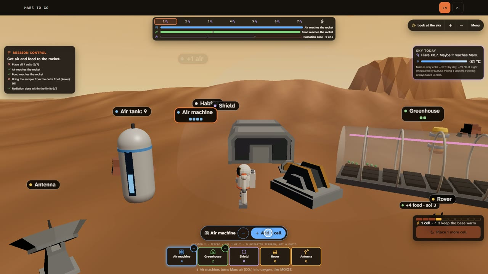 | 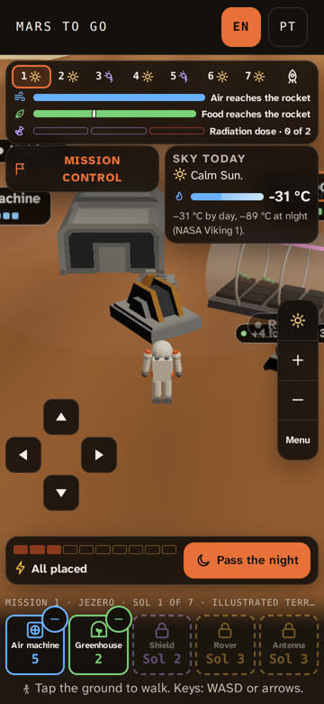 |

You walk an astronaut around a 3D base in Jezero Crater and plan each sol. Every sol you get **10 power cells**: **3 always keep the base warm** (Mars averages −59 °C), and you place the other **7** in five machines:

| Machine | What one cell does | What it costs |
| --- | --- | --- |
| **Air machine** | +1 air tonight (it turns Mars CO₂ into oxygen, like NASA's MOXIE did on Perseverance) | Four astronauts breathe 5 air every night |
| **Greenhouse** | +2 food, but only **2 sols later** (plants take time to grow) | Nothing tonight; plant early or go hungry |
| **Shield** | Blocks 1 point of radiation tonight | Spent even if the storm misses Mars |
| **Rover** (2 cells) | Drives to a real Jezero site and brings back a rock sample | 2 air for the suits and 1 dose point (the delta front: 3 air and 2 dose points) |
| **Antenna** (1 cell) | Earth tells you tonight whether tomorrow's storm will really reach Mars | One cell that makes no air and no food |

**One sol, step by step:**

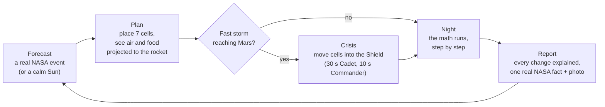

**Choices have consequences:**

- **Radiation dose limit.** If the crew's dose goes above the limit (2 points), the mission doctor sends everyone home. Radiation that gets past the Shield also damages electronics: you lose cells on the next sol.
- **The crisis.** When a fast storm reaches Mars, you see the risk against your Shield and choose which machine gives up cells to protect the crew; each option shows its cost (less air tonight, less food in two sols, no answer from Earth). You can also call the rover back.
- **Three results.** *Mission accomplished* needs everyone home, the rock sample and the dose within the limit. Otherwise it is *Mission with failures* (what failed) or *Early return* (why, with that night's numbers, and the sol where things went wrong).

| The night report | A real solar storm (mission 2) | The end |
| --- | --- | --- |
| 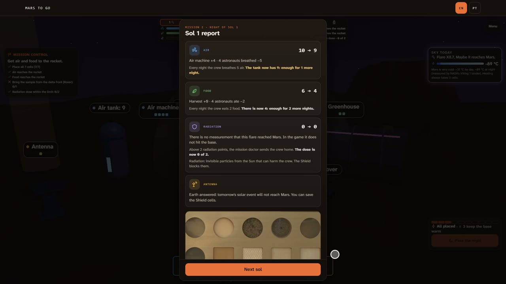 | 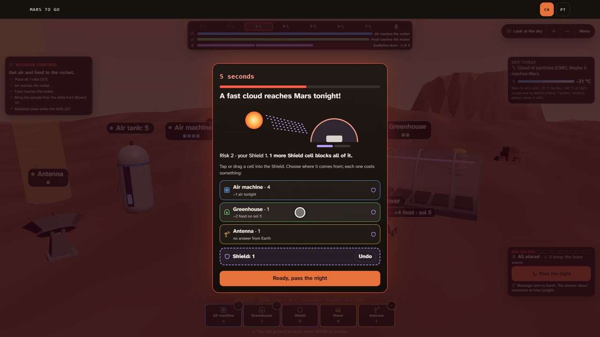 | 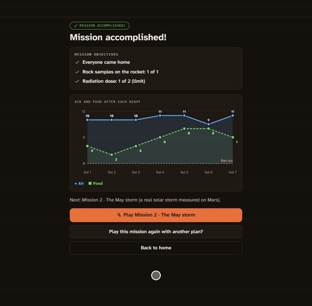 |

**On a phone:** tap the ground to walk or hold the on-screen direction pad, pinch to zoom, and use the large action button next to each machine. Everything can also be done from the bottom bar, the keyboard (WASD or arrows, E to add a cell) or a screen reader.

---

## 3. How the cell logic works

We wrote the rules on paper first ([`docs/en/SIM_MODEL.md`](docs/en/SIM_MODEL.md), approved before any screen existed), checked by hand that no single plan wins every time, and then turned the worked games into the first tests. The rules are a small, pure TypeScript engine with no UI code: [`packages/sim`](packages/sim).

### The numbers

Every number lives in one file, [`packages/sim/src/science.ts`](packages/sim/src/science.ts), with its value, unit, label (**measured**, **scenario** or **simplification**), source, URL, place and access date. Game rules are labeled as rules, never as measurements.

| Rule | Value | Label | The real fact it stands for |
| --- | --- | --- | --- |
| Cells per sol | 10 (3 for heating, 7 free) | scenario | Mars gets 43% of Earth's sunlight and is very cold (NASA Mars Fact Sheet) |
| Air at start / used per night | 10 / 5 | scenario | A crew of four breathes every sol (BVAD, NASA/TP-2015-218570) |
| Air per Air machine cell | 1 | scenario | Making oxygen from CO₂ costs power (MOXIE) |
| Food at start / eaten per night | 6 / 2 | scenario | Food brought from Earth |
| Food per Greenhouse cell | 2, arriving 2 sols later | simplification | Plants take time (real lettuce took 33 days on the ISS, Veggie) |
| Shield | blocks 1 risk point per cell | simplification | Shielding reduces the radiation that reaches the crew |
| Rover | 2 cells, 2 air, 1 dose point (far site: 3 air, 2 points) | scenario / simplification | Suits use stored oxygen; outside, the habitat no longer protects |
| Antenna | 1 cell; the answer arrives tonight | simplification | Radio signals take 4 to 24 minutes each way between Earth and Mars (measured) |
| Dose limit | 2 points | simplification | NASA sets career dose limits for astronauts (NASA-STD-3001); our points are not a real dose |
| Radiation damage | 1 cell lost next sol per unblocked point, max 2 | simplification | Radiation can damage electronics |

### The night, in order

`resolveNight(state, allocation)` in [`packages/sim/src/engine.ts`](packages/sim/src/engine.ts) runs these steps, and returns each one with `before`, `delta` and `after` so the report can show the math:

1. **Air machine:** `air += cells × 1`
2. **Harvest:** food planted two sols ago arrives
3. **Plant:** `greenhouse cells × 2` food is scheduled for sol + 2
4. **Breathe and eat:** `air −= 5`, `food −= 2`
5. **Rover:** `air −= 2` (3 for the delta front), one rock sample, dose +1 (+2)
6. **Radiation:** only if the event really reaches Mars, `dose += max(0, risk − shield)`; the Shield cells are spent either way
7. **Damage:** unblocked points cost cells on the next sol (max 2)
8. **Earth's answer:** if the Antenna had a cell, the answer about tomorrow appears tonight
9. **End check:** air or food below zero, or dose above the limit, ends the mission early

### A worked example (mission 1, sol 1)

The child places **5** cells in the Air machine and **2** in the Greenhouse:

- Air: 10 + 5 − 5 = **10** (enough for 2 more nights)
- Food: 6 + 0 − 2 = **4**; the 2 greenhouse cells will deliver 2 × 2 = **4 food on sol 3**
- Radiation: no event tonight, dose stays **0**

That is exactly the report the game shows (screenshot in section 2), and it is a test: the three worked games of the design document (`Guardian`, `Scientist`, `early return`) are reproduced number by number in [`engine.test.ts`](packages/sim/src/engine.test.ts).

### Why no choice is free (and no plan always wins)

In mission 2 there are 7 sols × 7 free cells = **49 cells**. A plan that shields every forecast and still meets the goal needs:

| Need | Cells |
| --- | --- |
| Air: the crew breathes 35 and the delta-front trip uses 3; the tank starts with 10 | 28 |
| Food: the crew eats 14; the store starts with 6 → 8 food at 2 per cell | 4 |
| Shield every forecast (six risk-2 events and the risk-3 storm) | 15 |
| Rover to the delta front | 2 |
| **Total** | **49 of 49** |

No margin at all: one mistake and the crew comes home early. But two of those forecasts are **false alarms** (NASA's model sent those CMEs to the Psyche spacecraft, not Mars). Asking Earth on sols 1 and 3 costs 2 cells and frees 4 Shield cells. **Information costs power, and it pays only if you plan ahead.** That is the kind of trade-off the challenge asks for, and it emerges from the numbers; it was not scripted.

The design document also proves, for the general case, that "everything" does not fit, that the Shield, the Greenhouse and the Antenna are never free, and that different plans win with different trade-offs ([SIM_MODEL §9](docs/en/SIM_MODEL.md#9-no-free-choice-no-single-winning-plan)).

### The projection: seeing the future before the night

As the child places cells, the trail at the top shows air and food "if every sol were like today", up to the rocket. A plan that runs out of air on sol 4 shows it *before* the night, not after ([`projection.ts`](packages/sim/src/projection.ts), [ADR-0031](docs/en/adr/0031-choice-and-consequence-on-one-screen.md)).

---

## 4. How we built the missions

### Mission 1 — "First sols" (guided)

Machines unlock over three sols, so a 7-year-old learns one idea at a time: Air machine and Greenhouse on sol 1, Shield on sol 2, Rover and Antenna on sol 3. Two real events from May 2024 arrive: an **M1.3 flare** (May 10, risk 1; no evidence it reached Mars) and a **CME** (May 11, risk 2; NASA's WSA-ENLIL model forecast a Mars arrival). Goal: everyone home, one rock sample, dose within the limit.

### Mission 2 — "The May storm"

All machines are open, and **every sol is a real NASA record** from May 13–20, 2024, a week of intense solar activity. The events are arranged into seven sols to build the story:

| Sol | Real event (NASA DONKI ID) | What NASA's data says | In the game |
| --- | --- | --- | --- |
| 1 | X8.7 flare, `2024-05-14T16:46:00-FLR-001` | No evidence it reached Mars | Risk 2, "maybe"; treated as not reaching Mars |
| 2 | CME, `2024-05-14T17:48:00-CME-001` | WSA-ENLIL forecast an impact at Psyche, not Mars | **False alarm** (the Antenna on sol 1 would tell you) |
| 3 | CME, `2024-05-13T09:12:00-CME-001` | Fast; WSA-ENLIL forecast a Mars arrival | Risk 2, **crisis** |
| 4 | CME, `2024-05-15T14:53:00-CME-001` | Forecast at Psyche, not Mars | **False alarm** |
| 5 | CME, `2024-05-14T17:30:00-CME-001` | Fast; Mars arrival forecast | Risk 2, **crisis** |
| 6 | CME, `2024-05-16T13:38:00-CME-001` | Fast; Mars arrival forecast | Risk 2, **crisis** |
| 7 | The May 20, 2024 storm (NASA/JPL release 2024-080) | Measured on the surface of Mars by Curiosity's RAD: the biggest radiation surge since it landed | Risk 3, **crisis** |

The rock sample must come from the **delta front**, 2.3 km away and NASA's best bet for finding signs of ancient life, which costs more air and more radiation ([ADR-0035](docs/en/adr/0035-delta-front-sample.md)).

### The rules that turn data into gameplay

- **Event → risk** (a simplification, stated on every event card): no event or C-class flare = 0; M-class flare = 1; X-class flare or a CME with a Mars arrival in WSA-ENLIL = 2; a particle storm measured at Mars = 3 ([SIM_MODEL §5](docs/en/SIM_MODEL.md#5-space-weather-event-class--game-risk-simplification)).
- **Does it reach Mars?** DONKI records what leaves the Sun; whether it reaches Mars depends on direction. Each event stores `reachesMars` with its evidence (a WSA-ENLIL impact list or a Mars measurement). Without evidence, it counts as not reaching Mars: we never invent a dose.
- **Fast storm → crisis:** a CME with DONKI's best speed of 1,000 km/s or more *and* a Mars arrival ([ADR-0034](docs/en/adr/0034-mission-2-may-storm.md)).

---

## 5. Real NASA data, with a trail

| Source | What the game uses | Where in the game |
| --- | --- | --- |
| **NASA CCMC DONKI** | Real solar flares and CMEs, and NASA's WSA-ENLIL forecasts of arrival at Mars | Each sol's forecast, the Antenna's answer, "The Sun this week" (live) |
| **Curiosity RAD** (NASA/JPL release 2024-080) | The May 20, 2024 storm measured on the surface of Mars | Mission 2, sol 7 |
| **NASA Mars Fact Sheet** (NSSDCA) | 95% CO₂ air, −89/−31 °C at the Viking 1 site, average −59 °C, 43% of Earth's sunlight | Heating cells, thermometer, power |
| **MOXIE**, **Veggie**, **BVAD** | Oxygen made from Mars air; lettuce grown on the ISS; oxygen a crew uses | Air machine, Greenhouse, data cards |
| **NASA-STD-3001** (Vol. 1 and technical briefs) | Astronaut dose limits; how astronauts breathe inside a suit | Dose limit card; a mission 2 fact |
| **NASA studies** (NTRS, Design Reference Architecture 5.0) | Oxygen stored in tanks, base power, suit CO₂, how far astronauts walk | Mission 2 facts, air tank, walking limit |
| **NASA Photojournal, images.nasa.gov, SVS, NASA Science** | Real photos: Jezero, Kodiak, Rochette, the delta front, the sky of Mars, MOXIE, plants on the ISS, the May 2024 flare, Apollo hardware | Home screen, night reports, data cards |

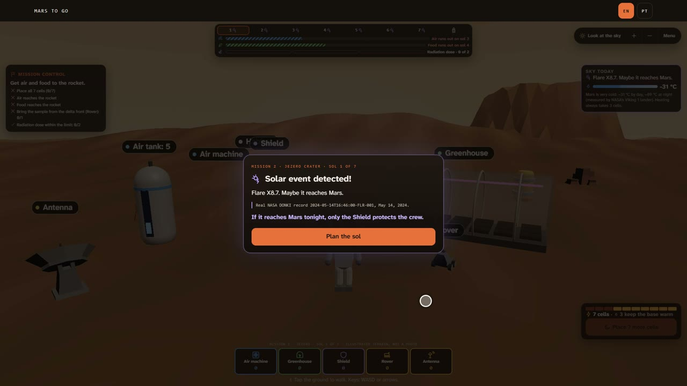

**The data trail (every screen):**

- **A card for every number.** Each data point opens a card with its source and record ID, where and when it was measured, how it was treated, how the game uses it, what was simplified, and a kid-level explanation with an everyday example. Cards, the in-game NASA data panel and the docs all come from the same source of truth ([`cards.ts`](packages/content/src/cards.ts), [`science.ts`](packages/sim/src/science.ts)); a test fails if a card is missing ([`cards.test.ts`](packages/content/src/cards.test.ts)).
- **Live is live, archive is archive.** The home screen's "The Sun this week" reads NASA DONKI **live** through our API service, labeled "LIVE" with the time it was fetched. If the service cannot be reached, it shows a dated copy saved twice a day by GitHub Actions, labeled as a copy. The missions use a curated archive, always shown with its dates. Static data is never presented as live.

  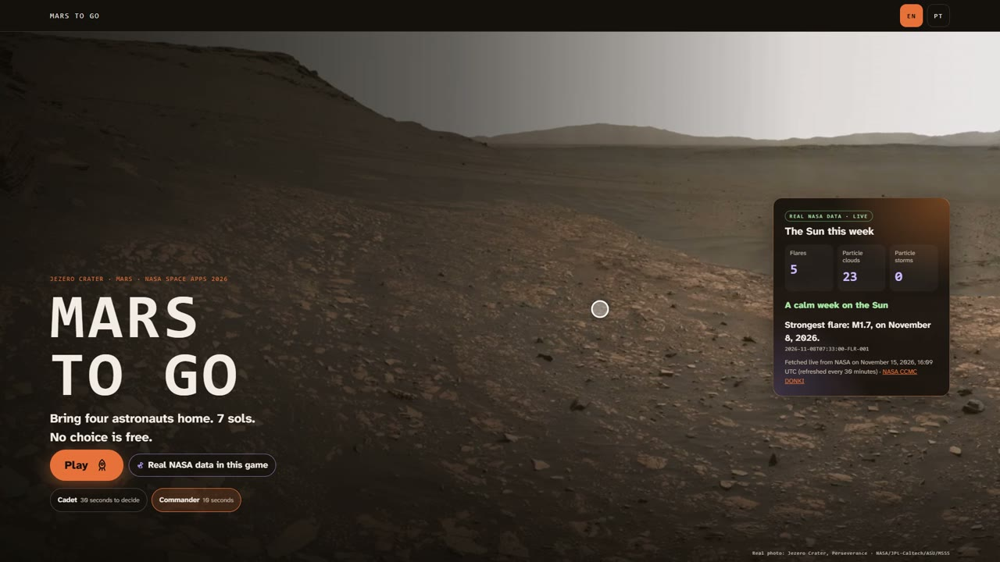
- **Mars first, parallels declared.** Anything not measured on Mars (ISS, Moon, Earth, Sun) is shown as a declared parallel, with the justification and what differs on Mars ([`docs/en/SCIENCE.md`](docs/en/SCIENCE.md), parallels P1–P16).
- **No fabricated doses.** The game never computes a Mars radiation dose; ISS measurements are labeled as ISS.

Sources, places and dates: [`docs/en/DATA_MAP.md`](docs/en/DATA_MAP.md).

---

## 6. The five judging criteria, with evidence

### Impact — "Does it change how a child thinks?"

**Claim:** a child leaves understanding a real constraint of deep-space survival: power is the budget behind air, food and protection, and information (asking Earth) is worth paying for.

**Evidence:**
- The challenge's five themes are playable decisions, each with a cost: life support, radiation shielding, power budgeting, food production and communication delay ([checklist B4](docs/en/CHALLENGE_CHECKLIST.md)).
- The math is shown, not hidden: live projection while planning, a step-by-step night, and a report with the conclusion in bold (section 3).
- A real child changed the game five times (section 7), and his own question ("how do astronauts breathe in a suit?") became NASA content in the game.
- Free, in the browser, on any device, in two languages: no barrier for a school or a family.
- Curriculum fit in Brazil: BNCC skill EF09CI16 asks students to argue about human survival outside Earth, which is exactly what the game makes them do (section 1).

### Creativity — "Is it a new way to learn this?"

**Claim:** a survival simulation driven by real space weather, not a quiz with a space theme.

**Evidence:**
- **Real events as gameplay.** Mission 2 turns a real week of NASA records into seven decisions, including NASA's own forecast misses (false alarms at Psyche), so the child learns why forecasts matter.
- **Emergent trade-offs.** The best plans use the Antenna to avoid shielding false alarms; nobody tells the child to do so (section 3).
- **A world to walk.** A 3D base in Jezero, built from CC0 low-poly models and drawn-in-code pieces, with the storm visible at night and a "Look at the sky" view with real NASA sky facts.
- **No single winning plan.** The design document's worked games show a careful "Guardian" plan and a "bet" plan both bringing the crew home with different trade-offs, while a greedy "Scientist" plan is sent home by the dose limit on night 2 ([SIM_MODEL §8–9 and §17](docs/en/SIM_MODEL.md#8-three-worked-games-become-the-first-tests)).
- **Original name.** As of November 2026, we found no existing game, app or registered product named "Mars to Go" (searches on the web, App Store, itch.io, Steam and GitHub; closest: an inactive 2022 GitHub demo and a 2021 Space Apps team named "To Mars We Go").

### Validity — "Document it and prove it"

**Claim:** the science and the math were defined and validated before the screens, and every claim can be checked.

**Evidence:**
- **Design approved before code:** simulation model, data map and architecture were approved in Phase 0 (tag `phase-0`, commit `be1c3d6`, the first commit of the repository).
- **Every constant has a source:** 54 entries in [`science.ts`](packages/sim/src/science.ts), each labeled measured, scenario or simplification, with source, URL, place and access date.
- **Every rule has a test, written first:** 58 simulation tests, including the three worked games of the design document, reproduced number by number ([`packages/sim/src/*.test.ts`](packages/sim/src)).
- **Every decision is recorded:** 35 architecture decision records ([`docs/en/adr/`](docs/en/adr/)), for example ADR-0033 (why a dose limit), ADR-0034 (why false alarms), ADR-0035 (why the delta front).
- **Honest limits:** what is simplified is written on the card and in section 15. NASA's wording is followed where it matters (for example, the mission 2 briefing calls the May 20 storm the biggest radiation surge Curiosity had measured since it landed, as NASA's release does).
- **Corrections are in the history:** design reviews and ADRs record what we got wrong and fixed, for example the first version, where air and food always won and radiation had no penalty, which ADR-0033 fixed with the dose limit and damage.

### Relevance — "Show it and prove it"

**Claim:** it answers the challenge item by item.

**Evidence:** an item-by-item checklist against the official text, with the file where each item is met: [`docs/en/CHALLENGE_CHECKLIST.md`](docs/en/CHALLENGE_CHECKLIST.md). Highlights:

| The challenge asks for | Mars to Go |
| --- | --- |
| Kids 7–12 manage a lunar or Martian outpost | A crewed base in Jezero Crater, Mars, 7 sols |
| Decisions about life support, shielding, power, food, communication delay | Air machine, Shield, 10-cell budget, Greenhouse, Antenna (answer arrives tonight; off during a crisis) |
| "No choice is free" | Every cell comes from the same 7; the Shield is spent even if the storm misses (section 3) |
| Ground it in real NASA data, e.g. DONKI | Every event is a DONKI record; mission 2 ends with the storm measured on Mars |
| Don't present static data as live | Live DONKI labeled "LIVE" with time; archive labeled with dates |
| Two or three core resources | Power, air, food (dose is a limit, not a fourth meter) |
| Browser, no download, no account | GitHub Pages, no login |
| Plain language; explain terms in context | Sol, flare, CME, dose explained in one sentence where they appear |
| Stand out: link shielding to real space weather; replayability; traceable data | Real May 2024 storms; "Play again with another plan" and "Go back to the sol where everything changed"; a data card for every number |

### Presentation — "Is it clear and inspiring?"

- A 29-second demo: real NASA photos of the Moon, Earth from Voyager 1 and Mars, then the game itself ([YouTube](https://youtu.be/zaAPhmpyvIg)).
- This README: the problem with sources, the game, the math, the data, the evidence.
- Everything bilingual (English and Portuguese), from the game to the docs ([`docs/en`](docs/en), [`docs/pt-BR`](docs/pt-BR)).

---

## 7. Tested with a real child

An 8-year-old played every version, on a computer and an iPhone 16: mission 1 on November 14 and mission 2 on November 15, 2026. The parent wrote down facts only, during and right after each session. The full log, with the commit each observation caused, is in [`docs/en/PLAYTEST.md`](docs/en/PLAYTEST.md).

| What he did | What changed | Commit |
| --- | --- | --- |
| Skipped the long opening text | Short bullets, one strong image, numbers you can see | `c66cfa9` |
| Waited for the flare: "nothing happened" | Solar storms became visible at night; a report explains every number | `c66cfa9`, `5bb50bb` |
| Played by walking up to machines, not with the bottom bar | An action button next to each machine ("+ Add 1 cell", key E) | `5bb50bb` |
| Thought the air machine was the crew's house | A real crew habitat in the base | `5bb50bb`, `3a23255` |
| Asked how astronauts breathe inside a suit | A mission 2 fact written from NASA-STD-3001 technical briefs, with a real photo of an Apollo suit backpack | `d77d8d2` |

Between sessions, the parent ran six design reviews on the computer and the phone (A to F, plus the home screen review G and the phone review H). They shaped most of the rules: the dose limit, the false alarms, the crisis with choices, the rover's site and the phone direction pad. No name, image or voice of the child appears in any file.

---

## 8. How we worked: method and timeline

### Rules we set for ourselves

From [`CLAUDE.md`](CLAUDE.md), the project rules:

1. **No free choice:** every option shows its cost.
2. **Mechanics before polish.**
3. **Three core resources** (power, air, food); a fourth meter needs an ADR.
4. **No constant outside `science.ts`;** never invent a value or a source.
5. **Live vs archived:** every data point shows its date.
6. **No fabricated Mars doses.**
7. **No UI text in code,** both languages complete.
8. **Accessibility, privacy, no minors' likeness, rights for every asset, AI disclosed.**
9. **Validate before building screens,** and **phase gates:** each phase is shown, validated and tagged before the next.

### Timeline (from the git history; nothing was rewritten)

| When (UTC−3) | Milestone | Commit / tag |
| --- | --- | --- |
| Nov 14, 12:31 | Phase 0: simulation model, data map, architecture | `be1c3d6`, tag `phase-0` |
| 12:46 | Phase 1: monorepo, bilingual home, API, CI and deploy | `febbf1a`, tag `phase-1` |
| 14:03 | Phase 2: the simulation, every rule tested | `06bd99b`, tag `phase-2` |
| 14:28 | Phase 3: a playable sol with live math and data cards (list screen) | `7ed9c30`, tag `phase-3` |
| 16:42 | Phase 3B: one screen, 7-sol trail, projection | `b5eddf5` |
| 18:05 | 3D world prototype | `74223a0` |
| 19:17 | Block 1, after the first playtest | `c66cfa9` |
| 21:54 | Choices with consequences: dose limit, damage, samples (ADR-0033) | `5bb50bb` |
| 23:24 | Mission 2 "The May storm" with the crisis | `22205ed` |
| Nov 15, 00:14 | Mission 2 harder and honest: false alarms (ADR-0034) | `f49362f` |
| 07:41 | Rover chooses its site; delta front sample (ADR-0035) | `8ae30de` |
| 10:20 | Security: Content Security Policy, no third-party requests | `3d85693` |
| 11:33 | Phone direction pad and toolbar | `9de3e5d` |

### The interface, three times

The same sol 1 plan in each version: a list (phase 3), one screen (phase 3B), and the 3D world after the first playtest. The rules never changed; only how a child sees them. The first two still run with `?ui=list` and `?ui=one`.

| Phase 3: list | Phase 3B: one screen | Today: 3D world |
| --- | --- | --- |
| 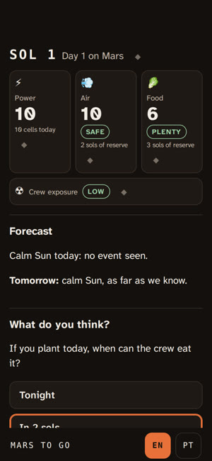 | 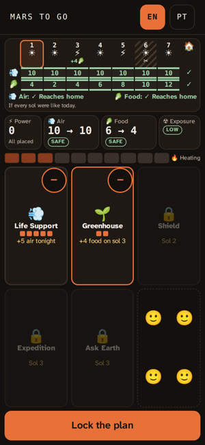 |  |

---

## 9. Architecture and infrastructure

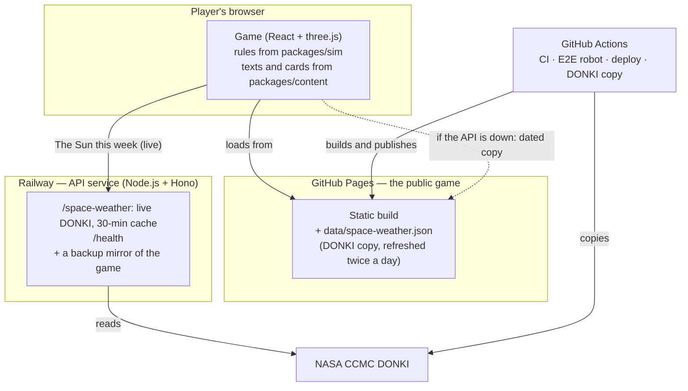

- **GitHub Pages is the public address of the game:** https://rafaelafeijo.github.io/mars-to-go/. It is rebuilt on every push to `main` and twice a day, to refresh the dated DONKI copy ([`pages.yml`](.github/workflows/pages.yml)).
- **Railway runs our API service** (Node.js + Hono, [`apps/api`](apps/api)): it reads NASA DONKI live for "The Sun this week" (cached for 30 minutes, no API key needed) and serves a health check. It also keeps a **backup mirror** of the game. It is infrastructure support: the game itself runs entirely from GitHub Pages, and if the API is unreachable the home screen falls back to the dated copy.
- **The rules are pure and separate.** `packages/sim` has no UI and no network code; the same functions run the preview while planning, the night, the projection and the tests.

```
apps/web          the game: React + Vite + three.js (@react-three/fiber)
apps/api          API service: Hono; /health, /space-weather (DONKI with cache), game mirror
packages/sim      pure game rules, test-first; science.ts holds every constant with its source
packages/content  texts in en and pt-BR, event catalog, data cards, NASA facts
packages/ui       design tokens
tools/data        Python scripts for images and data
scripts           end-to-end playthrough robot (Playwright)
docs/en, docs/pt-BR   documentation in both languages; docs/media holds README images
```

More: [`docs/en/ARCHITECTURE.md`](docs/en/ARCHITECTURE.md).

---

## 10. Quality: tests, security, performance

- **72 automated tests:** 58 for the simulation rules (engine, projection, career, science), 11 for content (every card matches `science.ts`; every text key exists in both languages), 3 for the API. Run with `pnpm test`; typecheck, lint and tests together with `pnpm check`, on every push ([`ci.yml`](.github/workflows/ci.yml)).
- **A robot plays the game on every push:** [`scripts/playthrough.mjs`](scripts/playthrough.mjs) builds the game and plays mission 1 in English and Portuguese and in all three interfaces, and mission 2 to the end, on a phone-size screen and a computer-size screen. It fails if the crew does not come home ([`e2e.yml`](.github/workflows/e2e.yml)); the screenshots in this README come from it and from a GPU recording of the same game.
- **Security:**
  - A strict Content Security Policy in the published game: scripts only from the game itself, network only to the game and our API service.
  - No referrer is sent.
  - No 3D decoder is downloaded from a CDN.
  - The robot fails on any third-party request or any Content Security Policy violation.
  - No secrets in the repository, and no source maps published.
- **Performance:** about 0.7 MB is transferred to reach the first sol, measured by the robot; low-poly models and a self-hosted font.

---

## 11. Accessibility, languages and privacy

- **Readable:** Atkinson Hyperlegible Next, a font designed for legibility, with short sentences and every scientific term explained in one sentence where it appears.
- **Touch and keyboard:** touch targets of at least 44 px; everything in 3D can also be done from the bottom bar, the keyboard or a screen reader.
- **Never color alone:** icons and words go with every color.
- **Calm by default:** reduced motion is respected, and the Cadet level gives 30 seconds in a crisis instead of 10.
- **Two languages, complete:** English and Portuguese; a test fails if a text key is missing in either.
- **Privacy:** no accounts, no analytics, no cookies, no personal data. The font is hosted with the game. The language choice stays on the device.
- **Not done yet:** a full WCAG 2.2 AA audit.

---

## 12. Run it locally

Requirements: Node 22 and pnpm (via `corepack enable`).

```bash
pnpm install
pnpm dev          # game at http://localhost:5173
pnpm dev:api      # API at http://localhost:8787 (/health, /space-weather)
pnpm check        # typecheck + lint + tests
pnpm build
node scripts/playthrough.mjs out en world   # plays missions 1 and 2 end to end (Playwright)
```

No API key is needed: DONKI is read from `ccmc.gsfc.nasa.gov` without a key.

---

## 13. Use of AI

- **The game:** no AI-generated media. Every photo is a real NASA image; the 3D models are Kenney (CC0); the astronaut, icons and terrain are drawn in code.
- **The demo video only:** its narration was generated with **Kokoro-82M**, an open-source AI text-to-speech tool (Apache-2.0). It does not imitate any real person, and this is stated on screen, in the YouTube description and in the file metadata. Everything else in the video is real: NASA photos and footage recorded from the game.
- **Code and docs:** written with **Claude Code** (Anthropic) under the team's direction and review; Claude Code was also used to find, read and check NASA sources. The game idea, the design decisions, the playtests and every review are the team's.

Details: [`docs/en/AI_USAGE.md`](docs/en/AI_USAGE.md).

---

## 14. Credits and licenses

- **NASA:** NASA, NASA/JPL-Caltech, CCMC (DONKI), and the partner institutions credited on each image, with source, credit and license in [`docs/en/ASSETS.md`](docs/en/ASSETS.md).
- **3D models:** Kenney Space Kit and Space Station Kit (CC0).
- **Font:** Atkinson Hyperlegible Next, Braille Institute (SIL OFL 1.1).
- **Demo video:**
  - Narration: Kokoro-82M (Apache-2.0).
  - Music: "Space" by leberch (Pixabay Content License).
  - Images: AS17-152-23311, AS08-14-2383, AS15-88-11901, PIA23645, PIA24921 (NASA, NASA/JPL-Caltech, ASU, MSSS).

This project is not affiliated with or endorsed by NASA. No NASA logos, insignia or mission identifiers are used.

**License:** code under [MIT](LICENSE). NASA data and images keep their own terms (see [ASSETS](docs/en/ASSETS.md)).

---

## 15. Limitations and next steps

**What is simplified (and said so in the game):**
- A power cell is not a real energy unit, and risk and dose points are not real doses.
- A CME arrives the same night in the game, while real ones take days.
- Mission 2 rearranges real records from one week into seven sols.
- The 3D terrain is an illustration inspired by Jezero, not a map.

**What is not built yet:**
- Mission 3 ("Dusty sky"), "Surprise me" and "Today in space" (live events inside a mission).
- Saving progress with a career code; the rules exist in [`code.ts`](packages/sim/src/code.ts), but the app saves only the language.
- A classroom mode, a "science behind" page with a public JSON of every card, and a full WCAG 2.2 AA audit.

**What we would measure next:** whether children can explain the trade-off in their own words after playing. Our only evidence so far is one tester, aged 8.
