# Mars to Go

**Mantenha uma tripulação viva em Marte com dados reais da NASA. Nenhuma escolha é grátis.**

[English](README.md) · NASA Space Apps Challenge 2026 · Desafio: *Build a Junior Astronaut Mission Trainer* ([texto oficial](docs/CHALLENGE_STATEMENT.md))

[](https://github.com/Rafaelafeijo/mars-to-go/actions/workflows/ci.yml)
[](https://github.com/Rafaelafeijo/mars-to-go/actions/workflows/e2e.yml)
[](https://github.com/Rafaelafeijo/mars-to-go/actions/workflows/pages.yml)

## ▶ Jogue agora: [rafaelafeijo.github.io/mars-to-go](https://rafaelafeijo.github.io/mars-to-go/)

Grátis, no navegador, sem download e sem conta. Fica melhor no computador, mas dá para jogar tudo no celular e no tablet. Abre em inglês; o português está a um toque (barra do topo).

- Ir direto para a missão 2: https://rafaelafeijo.github.io/mars-to-go/?mission=2
- Vídeo de demonstração de 29 segundos: https://youtu.be/zaAPhmpyvIg

[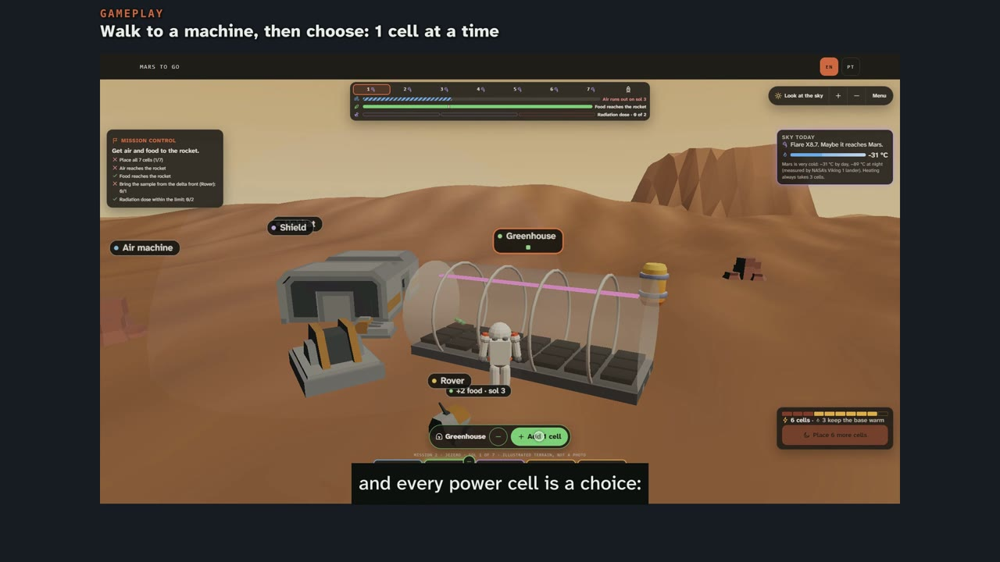](https://youtu.be/zaAPhmpyvIg)

---

## Em um parágrafo

Mars to Go é um jogo gratuito de navegador em que crianças de 7 a 12 anos comandam uma base tripulada na Cratera Jezero, em Marte, por sete sóis (um sol é um dia de Marte). A cada sol elas recebem um orçamento fixo de células de energia para dividir entre o ar, a comida, um escudo contra a radiação, um rover e uma antena para falar com a Terra. Nunca dá para tudo, então toda escolha mostra o seu custo: uma célula no escudo esta noite é ar que falta amanhã, e a comida plantada hoje só chega dois sóis depois. As tempestades solares são reais: cada evento é um registro do NASA DONKI de maio de 2024, e a missão 2 termina com a tempestade que o Curiosity mediu na superfície de Marte em 20 de maio de 2024. Depois de cada noite, o jogo explica a conta e mostra um fato real da NASA com uma foto real. Todo número mostra a sua fonte e a sua data.

**O valor, para uma criança:** ela aprende decidindo, não respondendo a um questionário. Sobreviver no espaço profundo é administrar um orçamento de energia, ar, comida e radiação sob o clima espacial real, e dados reais, com fonte e data, são a forma como astronautas e engenheiros decidem.

| | |
| --- | --- |
| **Para** | Crianças de 7 a 12 anos (nível Cadete para as menores; Comandante para as maiores, irmãos e pais) |
| **Onde** | Qualquer navegador atual: computador, celular ou tablet |
| **Idiomas** | Inglês e português, completos nos dois |
| **Dados** | NASA DONKI (arquivo e ao vivo), RAD do Curiosity, Mars Fact Sheet, MOXIE, Veggie, BVAD, NASA-STD-3001, fotos da NASA |
| **Time** | Rochette, um time de mãe e filho (o nome vem de uma rocha de Marte de onde o Perseverance tirou amostras) |
| **Custo para jogar** | Zero. Sem contas, sem anúncios, sem analytics, sem dados pessoais |

## Sumário

1. [Por que criamos o jogo](#1-por-que-criamos-o-jogo)
2. [Como se joga](#2-como-se-joga)
3. [Como funciona a lógica das células](#3-como-funciona-a-lógica-das-células)
4. [Como construímos as missões](#4-como-construímos-as-missões)
5. [Dados reais da NASA, com trilha](#5-dados-reais-da-nasa-com-trilha)
6. [Os cinco critérios de avaliação, com evidências](#6-os-cinco-critérios-de-avaliação-com-evidências)
7. [Testado com uma criança de verdade](#7-testado-com-uma-criança-de-verdade)
8. [Como trabalhamos: método e linha do tempo](#8-como-trabalhamos-método-e-linha-do-tempo)
9. [Arquitetura e infraestrutura](#9-arquitetura-e-infraestrutura)
10. [Qualidade: testes, segurança, desempenho](#10-qualidade-testes-segurança-desempenho)
11. [Acessibilidade, idiomas e privacidade](#11-acessibilidade-idiomas-e-privacidade)
12. [Como rodar localmente](#12-como-rodar-localmente)
13. [Uso de IA](#13-uso-de-ia)
14. [Créditos e licenças](#14-créditos-e-licenças)
15. [Limitações e próximos passos](#15-limitações-e-próximos-passos)

---

## 1. Por que criamos o jogo

### Uma mãe, um filho e uma pergunta

O time Rochette é uma mãe e o seu filho de 8 anos. Ele quer aprender tudo sobre o espaço e, quem sabe, ser astronauta um dia. Ela é desenvolvedora de software e está fazendo o seu primeiro jogo. Queríamos algo que ele pudesse *jogar* e que lhe ensinasse o que os pôsteres e os vídeos não ensinam: que cada dia em outro mundo é um conjunto de escolhas difíceis, e que as pessoas que fazem essas escolhas usam dados reais.

Ele foi o primeiro testador de todas as versões (seção 7). Nenhum nome, imagem ou voz dele aparece em parte alguma deste projeto.

### A lacuna que o desafio descreve é real

O desafio diz que as crianças costumam ver o resultado de uma missão, nunca as trocas por trás dele, e que o conteúdo sobre o espaço ou é abstrato demais ou técnico demais. A pesquisa sobre jogos educativos concorda:

- **A maioria dos apps "educativos" são fichas de exercício digitais.** Hirsh-Pasek et al. (2015) escrevem que a maioria dos apps do mercado pertence a uma "primeira onda" em que "apps are simply digital worksheets, games, and puzzles that have been reproduced in an e-format without any explicit consideration of how children learn …" (os apps são apenas fichas de exercício, jogos e quebra-cabeças passados para o formato digital sem levar em conta como as crianças aprendem) ([*Psychological Science in the Public Interest* 16(1):3–34](https://doi.org/10.1177/1529100615569721), p. 5).
- **58% dos apps de aprendizagem infantil mais baixados são de qualidade inferior.** Numa análise de conteúdo de 124 apps, 72 (58%) ficaram como de qualidade inferior, e 73% tiveram nota baixa em aprendizagem ativa, em que a nota mais baixa significa que o app "drills skills, and feels like an online workbook" (repete exercícios e parece uma apostila on-line). (Meyer et al., 2021, [*Journal of Children and Media*](https://doi.org/10.1080/17482798.2021.1882516))
- **Os questionários dominam; as simulações são raras.** Um mapeamento de 176 estudos sobre jogos educativos para celular (2019–2024) encontrou mecânicas de questionário em 40,91% dos estudos e de simulação em 10,80% (Sales & Oliveira, 2025, [*Journal on Interactive Systems*](https://doi.org/10.5753/jis.2025.5947), Tabela 4). O padrão se repete em outra área: uma revisão sistemática de 2025 sobre jogos educativos de cibersegurança para crianças (91 jogos em 68 artigos, 2010–2024) encontrou questionários em 41,8% dos jogos e simulações em 19,8% (Damenu et al., [arXiv:2508.17414](https://arxiv.org/abs/2508.17414), pré-publicação).

Mars to Go é uma simulação, não um questionário: a criança aprende decidindo, e depois vê a consequência e o motivo.

### No Brasil, onde vivemos

- **O tema está no currículo, mas só no 9º ano.** A Base Nacional Comum Curricular (BNCC) pede que alunos do 9º ano (por volta dos 14 anos) saibam "Selecionar argumentos sobre a viabilidade da sobrevivência humana fora da Terra, com base nas condições necessárias à vida, nas características dos planetas e nas distâncias e nos tempos envolvidos em viagens interplanetárias e interestelares." (habilidade EF09CI16, [documento oficial da BNCC, MEC](http://basenacionalcomum.mec.gov.br/images/BNCC_EI_EF_110518_versaofinal_site.pdf), página 352 do PDF). O Mars to Go traz a mesma pergunta mais cedo, para 7 a 12 anos, em forma de jogo.
- **Mas o ensino de astronomia é descrito como "simplista".** Um estudo de 2022 com professores de Ciências do 6º ao 9º ano afirma: "Os resultados apontam para um ensino simplista com diferentes falhas nas distintas esferas educacionais", e cita um estudo em que só 10% dos cursos de licenciatura em biologia do Paraná ofereciam astronomia básica (Buffon, Neves & Pereira, 2022, [*Ciência & Educação* 28:e22006](https://doi.org/10.1590/1516-731320220006)). Os livros didáticos "representam, muitas vezes, a única fonte de consulta utilizada pelo professor" (Langhi & Nardi, [*Caderno Brasileiro de Ensino de Física* 24(1)](https://periodicos.ufsc.br/index.php/fisica/article/view/6055)).
- **E o interesse é enorme.** 1.386.046 estudantes de 13.053 escolas participaram da Olimpíada Brasileira de Astronomia e Astronáutica (OBA) de 2023, com 74.694 professores ([relatório da OBA 2023](https://sistema.oba.org.br/sisglob/sisglob_arquivos/2026/Relatorio%20da%2026%20OBA%20-%202023-compactado.pdf)).

### E no mundo

Numa pesquisa on-line de 2019 feita pela The Harris Poll para o Grupo LEGO, com 1.000 crianças de 8 a 12 anos em cada um destes países, EUA, Reino Unido e China (30 de maio a 8 de junho de 2019), **86% disseram ter interesse em exploração espacial e 90% queriam aprender mais** ([Grupo LEGO, julho de 2019](https://www.lego.com/en-id/aboutus/news/2019/july/lego-group-kicks-off-global-program-to-inspire-the-next-generation-of-space-explorers-as-nasa-celebrates-50-years-of-moon-landing); uma pesquisa on-line encomendada por uma empresa de brinquedos). O nosso filho é um entre muitos.

---

## 2. Como se joga

| Computador | Celular |
| --- | --- |
| 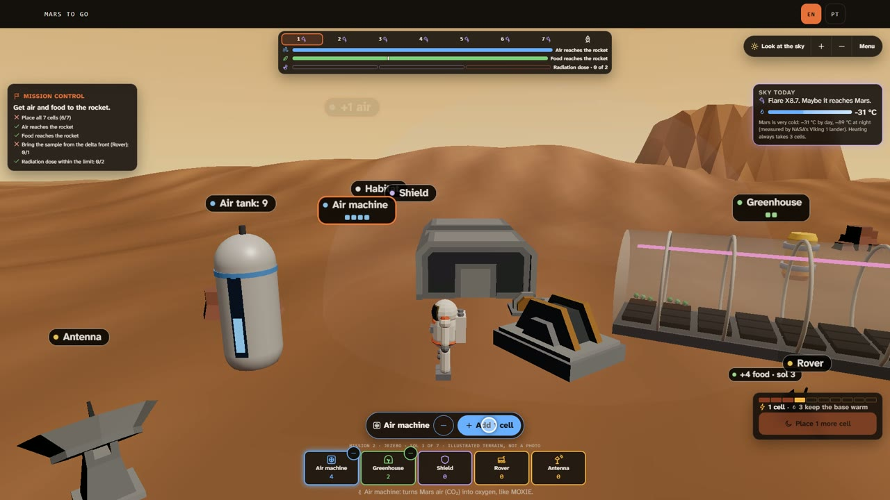 | 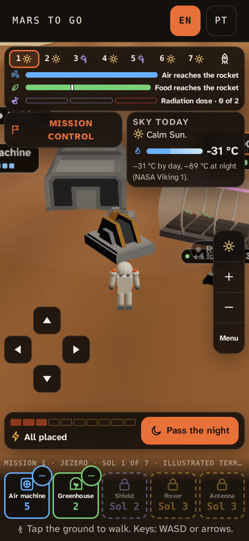 |

Você anda com um astronauta por uma base 3D na Cratera Jezero e planeja cada sol. A cada sol você recebe **10 células de energia**: **3 sempre aquecem a base** (a média de Marte é −59 °C), e você coloca as outras **7** em cinco máquinas:

| Máquina | O que uma célula faz | O que custa |
| --- | --- | --- |
| **Máquina de ar** | +1 de ar nesta noite (ela transforma o CO₂ de Marte em oxigênio, como fez o MOXIE da NASA no Perseverance) | Quatro astronautas respiram 5 de ar toda noite |
| **Estufa** | +2 de comida, mas só **2 sóis depois** (as plantas levam tempo para crescer) | Nada nesta noite; plante cedo ou passe fome |
| **Escudo** | Bloqueia 1 ponto de radiação nesta noite | É gasto mesmo se a tempestade não chegar a Marte |
| **Rover** (2 células) | Vai até um lugar real de Jezero e traz uma amostra de rocha | 2 de ar para os trajes e 1 ponto de dose (na frente do delta: 3 de ar e 2 pontos de dose) |
| **Antena** (1 célula) | A Terra diz, nesta noite, se a tempestade de amanhã vai mesmo chegar a Marte | Uma célula que não faz ar nem comida |

**Um sol, passo a passo:**

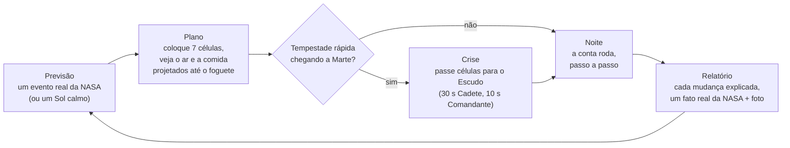

**As escolhas têm consequências:**

- **Limite de dose de radiação.** Se a dose da tripulação passa do limite (2 pontos), o médico da missão manda todos para casa. A radiação que passa pelo Escudo também estraga os eletrônicos: você perde células no sol seguinte.
- **A crise.** Quando uma tempestade rápida chega a Marte, você vê o risco contra o seu Escudo e escolhe qual máquina cede células para proteger a tripulação; cada opção mostra o seu custo (menos ar nesta noite, menos comida daqui a dois sóis, nenhuma resposta da Terra). Você também pode chamar o rover de volta.
- **Três resultados.** *Missão bem-sucedida* exige todos em casa, a amostra de rocha e a dose dentro do limite. Senão, o resultado é *Missão com falhas* (o que falhou) ou *Retorno antecipado* (o porquê, com os números daquela noite, e o sol em que as coisas deram errado).

| O relatório da noite | Uma tempestade solar real (missão 2) | O fim |
| --- | --- | --- |
| 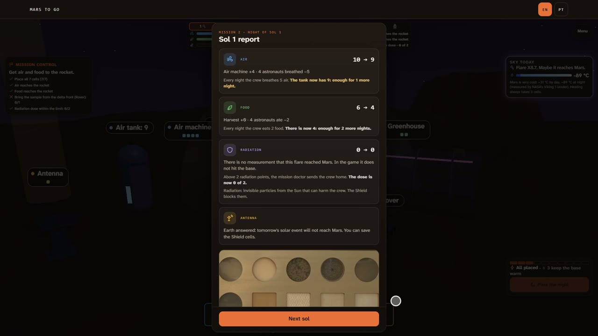 | 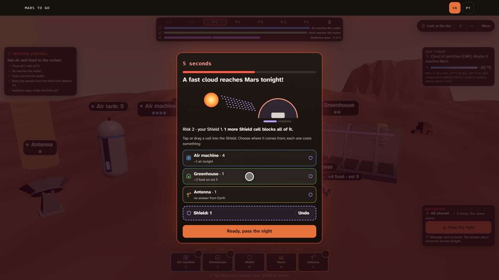 | 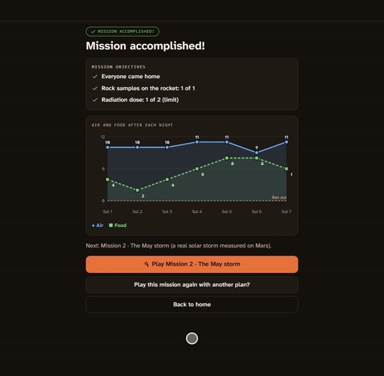 |

**No celular:** toque no chão para andar ou segure o direcional na tela, faça pinça para dar zoom e use o botão grande de ação ao lado de cada máquina. Tudo também pode ser feito pela barra de baixo, pelo teclado (WASD ou setas, E para pôr uma célula) ou com um leitor de tela.

---

## 3. Como funciona a lógica das células

Primeiro escrevemos as regras no papel ([`docs/pt-BR/SIM_MODEL.md`](docs/pt-BR/SIM_MODEL.md), aprovado antes de existir qualquer tela), conferimos à mão que nenhum plano único vence sempre e depois transformamos as partidas resolvidas nos primeiros testes. As regras são um motor pequeno e puro em TypeScript, sem código de interface: [`packages/sim`](packages/sim).

### Os números

Todo número fica em um único arquivo, [`packages/sim/src/science.ts`](packages/sim/src/science.ts), com valor, unidade, rótulo (**medido**, **cenário** ou **simplificação**), fonte, URL, lugar e data de acesso. Regras do jogo são rotuladas como regras, nunca como medições.

| Regra | Valor | Rótulo | O fato real que ela representa |
| --- | --- | --- | --- |
| Células por sol | 10 (3 para aquecer, 7 livres) | cenário | Marte recebe 43% da luz do Sol que a Terra recebe e é muito frio (NASA Mars Fact Sheet) |
| Ar no início / gasto por noite | 10 / 5 | cenário | Uma tripulação de quatro pessoas respira todo sol (BVAD, NASA/TP-2015-218570) |
| Ar por célula na Máquina de ar | 1 | cenário | Fazer oxigênio a partir de CO₂ gasta energia (MOXIE) |
| Comida no início / consumida por noite | 6 / 2 | cenário | Comida trazida da Terra |
| Comida por célula na Estufa | 2, chegando 2 sóis depois | simplificação | As plantas levam tempo (a alface de verdade levou 33 dias na ISS, Veggie) |
| Escudo | bloqueia 1 ponto de risco por célula | simplificação | A blindagem reduz a radiação que chega à tripulação |
| Rover | 2 células, 2 de ar, 1 ponto de dose (lugar distante: 3 de ar, 2 pontos) | cenário / simplificação | Os trajes usam oxigênio guardado; lá fora, o habitat não protege mais |
| Antena | 1 célula; a resposta chega nesta noite | simplificação | Os sinais de rádio levam de 4 a 24 minutos em cada sentido entre a Terra e Marte (medido) |
| Limite de dose | 2 pontos | simplificação | A NASA define limites de dose para a carreira dos astronautas (NASA-STD-3001); os nossos pontos não são uma dose real |
| Dano por radiação | 1 célula perdida no sol seguinte por ponto não bloqueado, no máximo 2 | simplificação | A radiação pode estragar eletrônicos |

### A noite, em ordem

`resolveNight(state, allocation)` em [`packages/sim/src/engine.ts`](packages/sim/src/engine.ts) roda estes passos e devolve cada um com `before`, `delta` e `after`, para que o relatório possa mostrar a conta:

1. **Máquina de ar:** `air += cells × 1`
2. **Colheita:** chega a comida plantada dois sóis antes
3. **Plantio:** `greenhouse cells × 2` de comida fica marcada para o sol + 2
4. **Respirar e comer:** `air −= 5`, `food −= 2`
5. **Rover:** `air −= 2` (3 para a frente do delta), uma amostra de rocha, dose +1 (+2)
6. **Radiação:** só se o evento chegar mesmo a Marte, `dose += max(0, risk − shield)`; as células do Escudo são gastas de qualquer jeito
7. **Dano:** os pontos não bloqueados custam células no sol seguinte (no máximo 2)
8. **Resposta da Terra:** se a Antena teve uma célula, a resposta sobre amanhã aparece nesta noite
9. **Verificação de fim:** ar ou comida abaixo de zero, ou dose acima do limite, encerra a missão antes da hora

### Um exemplo resolvido (missão 1, sol 1)

A criança coloca **5** células na Máquina de ar e **2** na Estufa:

- Ar: 10 + 5 − 5 = **10** (o bastante para mais 2 noites)
- Comida: 6 + 0 − 2 = **4**; as 2 células da Estufa vão entregar 2 × 2 = **4 de comida no sol 3**
- Radiação: nenhum evento nesta noite, a dose continua **0**

É o relatório que o jogo mostra depois dessa noite:

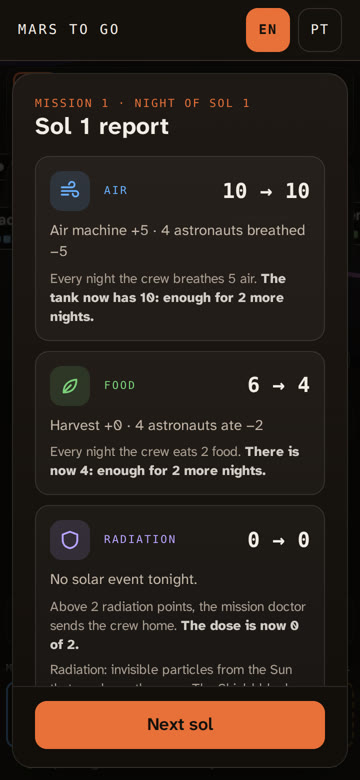

As regras são testadas do mesmo jeito: as três partidas resolvidas do documento de design (`Guardian`, `Scientist`, `early return`) são reproduzidas número por número em [`engine.test.ts`](packages/sim/src/engine.test.ts).

### Por que nenhuma escolha é de graça (e nenhum plano vence sempre)

Na missão 2 há 7 sóis × 7 células livres = **49 células**. Um plano que protege toda previsão com o Escudo e ainda cumpre o objetivo precisa de:

| Necessidade | Células |
| --- | --- |
| Ar: a tripulação respira 35 e a ida à frente do delta usa 3; o tanque começa com 10 | 28 |
| Comida: a tripulação come 14; o estoque começa com 6 → 8 de comida a 2 por célula | 4 |
| Escudo em toda previsão (seis eventos de risco 2 e a tempestade de risco 3) | 15 |
| Rover até a frente do delta | 2 |
| **Total** | **49 de 49** |

Nenhuma margem: um erro e a tripulação volta para casa antes da hora. Mas duas dessas previsões são **alarmes falsos** (o modelo da NASA mandou essas CMEs para a nave Psyche, não para Marte). Perguntar à Terra nos sóis 1 e 3 custa 2 células e libera 4 células do Escudo. **Informação custa energia, e só compensa se você planejar com antecedência.** É o tipo de troca que o desafio pede, e ela nasce dos números; não foi roteirizada.

O documento de design também prova, para o caso geral, que "tudo" não cabe, que o Escudo, a Estufa e a Antena nunca são de graça, e que planos diferentes vencem com trocas diferentes ([SIM_MODEL §9](docs/pt-BR/SIM_MODEL.md#9-nenhuma-escolha-de-graça-nenhum-plano-vencedor-único)).

### A projeção: ver o futuro antes da noite

Enquanto a criança coloca as células, a trilha no topo mostra o ar e a comida "se todo sol fosse igual a hoje", até o foguete. Um plano que fica sem ar no sol 4 aparece *antes* da noite, não depois ([`projection.ts`](packages/sim/src/projection.ts), [ADR-0031](docs/pt-BR/adr/0031-escolha-e-consequencia-na-mesma-tela.md)).

---

## 4. Como construímos as missões

### Missão 1 — "Primeiros sóis" (guiada)

As máquinas abrem ao longo de três sóis, para que uma criança de 7 anos aprenda uma ideia de cada vez: Máquina de ar e Estufa no sol 1, Escudo no sol 2, Rover e Antena no sol 3. Chegam dois eventos reais de maio de 2024: uma **erupção M1.3** (10 de maio, risco 1; não há evidência de que tenha chegado a Marte) e uma **CME** (11 de maio, risco 2; o modelo WSA-ENLIL da NASA previu a chegada a Marte). Objetivo: todos em casa, uma amostra de rocha, dose dentro do limite.

### Missão 2 — "A tempestade de maio"

Todas as máquinas estão abertas, e **cada sol é um registro real da NASA** de 13 a 20 de maio de 2024, uma semana de atividade solar intensa. Os eventos foram organizados em sete sóis para construir a história:

| Sol | Evento real (ID no NASA DONKI) | O que dizem os dados da NASA | No jogo |
| --- | --- | --- | --- |
| 1 | Erupção X8.7, `2024-05-14T16:46:00-FLR-001` | Não há evidência de que tenha chegado a Marte | Risco 2, "talvez"; tratada como se não chegasse a Marte |
| 2 | CME, `2024-05-14T17:48:00-CME-001` | O WSA-ENLIL previu um impacto na Psyche, não em Marte | **Alarme falso** (a Antena no sol 1 avisaria) |
| 3 | CME, `2024-05-13T09:12:00-CME-001` | Rápida; o WSA-ENLIL previu a chegada a Marte | Risco 2, **crise** |
| 4 | CME, `2024-05-15T14:53:00-CME-001` | Prevista para a Psyche, não para Marte | **Alarme falso** |
| 5 | CME, `2024-05-14T17:30:00-CME-001` | Rápida; chegada a Marte prevista | Risco 2, **crise** |
| 6 | CME, `2024-05-16T13:38:00-CME-001` | Rápida; chegada a Marte prevista | Risco 2, **crise** |
| 7 | A tempestade de 20 de maio de 2024 (comunicado NASA/JPL 2024-080) | Medida na superfície de Marte pelo RAD do Curiosity: o maior pico de radiação desde o seu pouso | Risco 3, **crise** |

A amostra de rocha precisa vir da **frente do delta**, a 2,3 km de distância e a melhor aposta da NASA para achar sinais de vida antiga, o que custa mais ar e mais radiação ([ADR-0035](docs/pt-BR/adr/0035-amostra-da-frente-do-delta.md)).

### As regras que transformam dados em jogo

- **Evento → risco** (uma simplificação, dita em todo cartão de evento): nenhum evento ou erupção de classe C = 0; erupção de classe M = 1; erupção de classe X ou CME com chegada a Marte no WSA-ENLIL = 2; tempestade de partículas medida em Marte = 3 ([SIM_MODEL §5](docs/pt-BR/SIM_MODEL.md#5-clima-espacial-classe-do-evento--risco-no-jogo-simplificação)).
- **Chega a Marte?** O DONKI registra o que sai do Sol; chegar ou não a Marte depende da direção. Cada evento guarda `reachesMars` com a sua evidência (uma lista de impactos do WSA-ENLIL ou uma medição em Marte). Sem evidência, conta como não chegando a Marte: nunca inventamos uma dose.
- **Tempestade rápida → crise:** uma CME com a melhor velocidade do DONKI de 1.000 km/s ou mais *e* com chegada a Marte ([ADR-0034](docs/pt-BR/adr/0034-missao-2-tempestade-de-maio.md)).

---

## 5. Dados reais da NASA, com trilha

| Fonte | O que o jogo usa | Onde no jogo |
| --- | --- | --- |
| **NASA CCMC DONKI** | Erupções solares e CMEs reais, e as previsões do modelo WSA-ENLIL da NASA de chegada a Marte | A previsão de cada sol, a resposta da Antena, "O Sol nesta semana" (ao vivo) |
| **RAD do Curiosity** (comunicado NASA/JPL 2024-080) | A tempestade de 20 de maio de 2024 medida na superfície de Marte | Missão 2, sol 7 |
| **NASA Mars Fact Sheet** (NSSDCA) | Ar com 95% de CO₂, −89/−31 °C no local da Viking 1, média de −59 °C, 43% da luz do Sol que a Terra recebe | Células de aquecimento, termômetro, energia |
| **MOXIE**, **Veggie**, **BVAD** | Oxigênio feito com o ar de Marte; alface cultivada na ISS; o oxigênio que uma tripulação usa | Máquina de ar, Estufa, cartões de dados |
| **NASA-STD-3001** (Vol. 1 e resumos técnicos) | Limites de dose dos astronautas; como os astronautas respiram dentro do traje | Cartão do limite de dose; um fato da missão 2 |
| **Estudos da NASA** (NTRS, Design Reference Architecture 5.0) | Oxigênio guardado em tanques, energia da base, CO₂ no traje, até onde os astronautas andam | Fatos da missão 2, tanque de ar, limite ao andar |
| **NASA Photojournal, images.nasa.gov, SVS, NASA Science** | Fotos reais: Jezero, Kodiak, Rochette, a frente do delta, o céu de Marte, o MOXIE, plantas na ISS, a erupção de maio de 2024, equipamentos da Apollo | Tela inicial, relatórios da noite, cartões de dados |

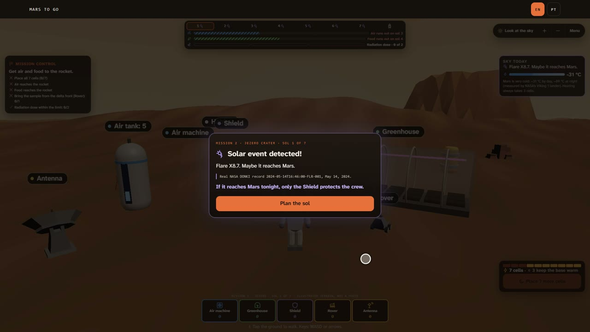

**A trilha do dado (em toda tela):**

- **Um cartão para cada número.** Cada dado abre um cartão com a sua fonte e o ID do registro, onde e quando foi medido, como foi tratado, como o jogo o usa, o que foi simplificado e uma explicação para crianças com um exemplo do dia a dia. Os cartões, o painel de dados da NASA dentro do jogo e a documentação vêm todos da mesma fonte da verdade ([`cards.ts`](packages/content/src/cards.ts), [`science.ts`](packages/sim/src/science.ts)); um teste falha se faltar um cartão ([`cards.test.ts`](packages/content/src/cards.test.ts)).
- **Ao vivo é ao vivo, arquivo é arquivo.** O "O Sol nesta semana" da tela inicial lê o NASA DONKI **ao vivo** pelo nosso serviço de API, com o selo "AO VIVO" e o horário em que foi buscado. Se o serviço não responder, mostra uma cópia datada, salva duas vezes por dia pelo GitHub Actions e identificada como cópia. As missões usam um arquivo selecionado, sempre mostrado com as suas datas. Dado estático nunca aparece como ao vivo.

  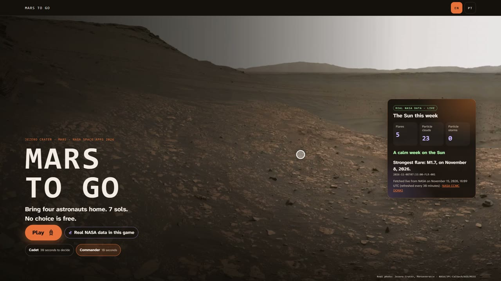
- **Marte primeiro, paralelos declarados.** Tudo o que não foi medido em Marte (ISS, Lua, Terra, Sol) aparece como um paralelo declarado, com a justificativa e o que é diferente em Marte ([`docs/pt-BR/SCIENCE.md`](docs/pt-BR/SCIENCE.md), paralelos P1–P16).
- **Nenhuma dose inventada.** O jogo nunca calcula uma dose de radiação em Marte; as medições da ISS são identificadas como da ISS.

Fontes, lugares e datas: [`docs/pt-BR/DATA_MAP.md`](docs/pt-BR/DATA_MAP.md).

---

## 6. Os cinco critérios de avaliação, com evidências

### Impacto — "Muda a forma como uma criança pensa?"

**Afirmação:** a criança sai entendendo uma restrição real da sobrevivência no espaço profundo: a energia é o orçamento por trás do ar, da comida e da proteção, e a informação (perguntar à Terra) vale o que custa.

**Evidências:**
- Os cinco temas do desafio são decisões jogáveis, cada uma com um custo: suporte de vida, blindagem contra radiação, orçamento de energia, produção de comida e atraso na comunicação ([checklist B4](docs/pt-BR/CHALLENGE_CHECKLIST.md)).
- A conta é mostrada, não escondida: projeção ao vivo durante o planejamento, uma noite passo a passo e um relatório com a conclusão em negrito (seção 3).
- Uma criança de verdade mudou o jogo cinco vezes (seção 7), e a pergunta dela ("como os astronautas respiram no traje?") virou conteúdo da NASA no jogo.
- Grátis, no navegador, em qualquer aparelho, em dois idiomas: nenhuma barreira para uma escola ou uma família.
- Ligação com o currículo brasileiro: a habilidade EF09CI16 da BNCC, do 9º ano, pede que os alunos argumentem se os humanos podem sobreviver fora da Terra; o jogo traz essa pergunta mais cedo, para 7 a 12 anos, por meio de decisões que as próprias crianças tomam (seção 1).

### Criatividade — "É um jeito novo de aprender isso?"

**Afirmação:** uma simulação de sobrevivência movida pelo clima espacial real, não um questionário com tema espacial.

**Evidências:**
- **Eventos reais como jogo.** A missão 2 transforma uma semana real de registros da NASA em sete decisões, incluindo as previsões erradas da própria NASA (alarmes falsos na Psyche), para que a criança aprenda por que as previsões importam.
- **Trocas que surgem sozinhas.** Os melhores planos usam a Antena para não gastar Escudo com alarmes falsos; ninguém diz à criança para fazer isso (seção 3).
- **Um mundo para andar.** Uma base 3D em Jezero, feita com modelos low-poly CC0 e peças desenhadas em código, com a tempestade visível à noite e uma vista "Olhar o céu" com fatos reais da NASA sobre o céu.
- **Nenhum plano vencedor único.** As partidas resolvidas do documento de design mostram um plano cuidadoso, "Guardião", e um plano de "aposta" trazendo a tripulação de volta com trocas diferentes, enquanto um plano ganancioso, "Cientista", é mandado para casa pelo limite de dose na noite 2 ([SIM_MODEL §8–9 e §17](docs/pt-BR/SIM_MODEL.md#8-três-partidas-resolvidas-viram-os-primeiros-testes)).
- **Nome original.** Em novembro de 2026, não encontramos nenhum jogo, app ou produto registrado com o nome "Mars to Go" (buscas na web, App Store, itch.io, Steam e GitHub; o mais próximo: uma demonstração inativa de 2022 no GitHub e um time do Space Apps de 2021 chamado "To Mars We Go").

### Validade — "Documente e prove"

**Afirmação:** a ciência e a conta foram definidas e validadas antes das telas, e toda afirmação pode ser conferida.

**Evidências:**
- **Design aprovado antes do código:** o modelo de simulação, o mapa de dados e a arquitetura foram aprovados na Fase 0 (tag `phase-0`, commit `be1c3d6`, o primeiro commit do repositório).
- **Toda constante tem fonte:** 54 entradas em [`science.ts`](packages/sim/src/science.ts), cada uma rotulada como medida, cenário ou simplificação, com fonte, URL, lugar e data de acesso.
- **Toda regra tem um teste, escrito antes:** 58 testes da simulação, incluindo as três partidas resolvidas do documento de design, reproduzidas número por número ([`packages/sim/src/*.test.ts`](packages/sim/src)).
- **Toda decisão está registrada:** 35 registros de decisão de arquitetura ([`docs/pt-BR/adr/`](docs/pt-BR/adr/)), por exemplo a ADR-0033 (por que um limite de dose), a ADR-0034 (por que alarmes falsos) e a ADR-0035 (por que a frente do delta).
- **Limites honestos:** o que é simplificado está escrito no cartão e na seção 15. Seguimos a redação da NASA onde ela importa (por exemplo, o briefing da missão 2 chama a tempestade de 20 de maio de o maior pico de radiação que o Curiosity tinha medido desde o pouso, como faz o comunicado da NASA).
- **As correções estão no histórico:** as revisões de design e as ADRs registram o que erramos e corrigimos, por exemplo a primeira versão, em que o ar e a comida sempre venciam e a radiação não tinha penalidade, o que a ADR-0033 corrigiu com o limite de dose e o dano.

### Relevância — "Mostre e prove"

**Afirmação:** o jogo responde ao desafio item por item.

**Evidências:** um checklist item por item contra o texto oficial, com o arquivo onde cada item é atendido: [`docs/pt-BR/CHALLENGE_CHECKLIST.md`](docs/pt-BR/CHALLENGE_CHECKLIST.md). Destaques:

| O desafio pede | Mars to Go |
| --- | --- |
| Crianças de 7 a 12 anos administram um posto avançado na Lua ou em Marte | Uma base tripulada na Cratera Jezero, em Marte, por 7 sóis |
| Decisões sobre suporte de vida, blindagem, energia, comida e atraso na comunicação | Máquina de ar, Escudo, orçamento de 10 células, Estufa, Antena (a resposta chega nesta noite; desligada durante uma crise) |
| "No choice is free" (nenhuma escolha é de graça) | Toda célula sai das mesmas 7; o Escudo é gasto mesmo se a tempestade não vier (seção 3) |
| Basear-se em dados reais da NASA, por exemplo o DONKI | Todo evento é um registro do DONKI; a missão 2 termina com a tempestade medida em Marte |
| Não apresentar dado estático como ao vivo | DONKI ao vivo com o selo "AO VIVO" e o horário; arquivo identificado com as datas |
| Dois ou três recursos centrais | Energia, ar, comida (a dose é um limite, não um quarto medidor) |
| Navegador, sem download, sem conta | GitHub Pages, sem login |
| Linguagem simples; explicar os termos no contexto | Sol, erupção, CME e dose explicados em uma frase onde aparecem |
| Para se destacar: ligar a blindagem ao clima espacial real; rejogabilidade; dados rastreáveis | Tempestades reais de maio de 2024; "Quer jogar esta missão de novo com outro plano?" e "Voltar ao sol em que tudo mudou"; um cartão de dados para cada número |

### Apresentação — "É claro e inspirador?"

- Uma demonstração de 29 segundos: fotos reais da NASA da Lua, da Terra vista pela Voyager 1 e de Marte, e depois o próprio jogo ([YouTube](https://youtu.be/zaAPhmpyvIg)).
- Este README: o problema, com fontes; o jogo; a conta; os dados; as evidências.
- Tudo bilíngue (inglês e português), do jogo à documentação ([`docs/en`](docs/en), [`docs/pt-BR`](docs/pt-BR)).

---

## 7. Testado com uma criança de verdade

Uma criança de 8 anos jogou todas as versões, num computador e num iPhone 16: a missão 1 em 14 de novembro e a missão 2 em 15 de novembro de 2026. A mãe anotou só fatos, durante cada sessão e logo depois. O registro completo, com o commit que cada observação gerou, está em [`docs/pt-BR/PLAYTEST.md`](docs/pt-BR/PLAYTEST.md).

| O que ele fez | O que mudou | Commit |
| --- | --- | --- |
| Pulou o texto longo de abertura | Tópicos curtos, uma imagem forte, números que dá para ver | `c66cfa9` |
| Esperou a erupção: "não aconteceu nada" | As tempestades solares ficaram visíveis à noite; um relatório explica cada número | `c66cfa9`, `5bb50bb` |
| Jogava andando até as máquinas, não pela barra de baixo | Um botão de ação ao lado de cada máquina ("+ Pôr 1 célula", tecla E) | `5bb50bb` |
| Achou que a Máquina de ar era a casa da tripulação | Um habitat de verdade para a tripulação na base | `5bb50bb`, `3a23255` |
| Perguntou como os astronautas respiram dentro do traje | Um fato da missão 2 escrito a partir dos resumos técnicos da NASA-STD-3001, com uma foto real da mochila de um traje da Apollo | `d77d8d2` |

Entre as sessões, a mãe fez seis revisões de design no computador e no celular (de A a F, mais a revisão G da tela inicial e a revisão H do celular). Elas definiram a maior parte das regras: o limite de dose, os alarmes falsos, a crise com escolhas, o lugar do rover e o direcional no celular. Nenhum nome, imagem ou voz da criança aparece em nenhum arquivo.

---

## 8. Como trabalhamos: método e linha do tempo

### As regras que definimos para nós

Do [`CLAUDE.md`](CLAUDE.md), as regras do projeto:

1. **Nenhuma escolha de graça:** toda opção mostra o seu custo.
2. **Mecânica antes de acabamento.**
3. **Três recursos centrais** (energia, ar, comida); um quarto medidor exige uma ADR.
4. **Nenhuma constante fora do `science.ts`;** nunca inventar um valor ou uma fonte.
5. **Ao vivo vs. arquivo:** todo dado mostra a sua data.
6. **Nenhuma dose inventada em Marte.**
7. **Nenhum texto de interface no código,** os dois idiomas completos.
8. **Acessibilidade, privacidade, nenhuma imagem de menores, direitos de todo recurso, IA declarada.**
9. **Validar antes de desenhar telas,** e **portões de fase:** cada fase é mostrada, validada e marcada com uma tag antes da próxima.

### Linha do tempo (do histórico do git; nada foi reescrito)

| Quando (UTC−3) | Marco | Commit / tag |
| --- | --- | --- |
| 14 nov., 12:31 | Fase 0: modelo de simulação, mapa de dados, arquitetura | `be1c3d6`, tag `phase-0` |
| 12:46 | Fase 1: monorepo, tela inicial bilíngue, API, CI e deploy | `febbf1a`, tag `phase-1` |
| 14:03 | Fase 2: a simulação, com cada regra testada | `06bd99b`, tag `phase-2` |
| 14:28 | Fase 3: um sol jogável com a conta ao vivo e cartões de dados (tela em lista) | `7ed9c30`, tag `phase-3` |
| 16:42 | Fase 3B: uma tela só, trilha de 7 sóis, projeção | `b5eddf5` |
| 18:05 | Protótipo do mundo 3D | `74223a0` |
| 19:17 | Bloco 1, depois do primeiro teste com a criança | `c66cfa9` |
| 21:54 | Escolhas com consequência: limite de dose, dano, amostras (ADR-0033) | `5bb50bb` |
| 23:24 | Missão 2 "A tempestade de maio", com a crise | `22205ed` |
| 15 nov., 00:14 | Missão 2 mais difícil e honesta: alarmes falsos (ADR-0034) | `f49362f` |
| 07:41 | O rover escolhe o lugar; amostra da frente do delta (ADR-0035) | `8ae30de` |
| 10:20 | Segurança: Content Security Policy, nenhum pedido a terceiros | `3d85693` |
| 11:33 | Direcional e barra de ferramentas no celular | `9de3e5d` |

### A interface, três vezes

O mesmo plano do sol 1 em cada versão: uma lista (fase 3), uma tela só (fase 3B) e o mundo 3D depois do primeiro teste com a criança. As regras nunca mudaram; só a forma como uma criança as vê. As duas primeiras ainda funcionam com `?ui=list` e `?ui=one`.

| Fase 3: lista | Fase 3B: uma tela só | Hoje: mundo 3D |
| --- | --- | --- |
| 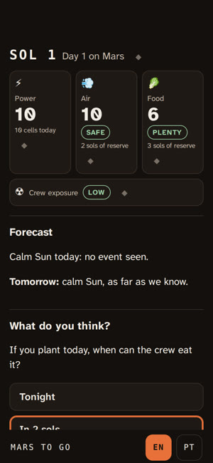 | 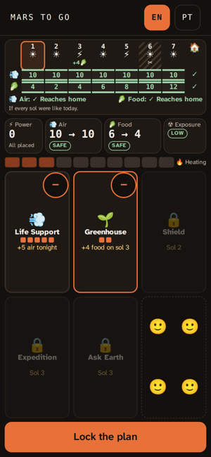 |  |

---

## 9. Arquitetura e infraestrutura

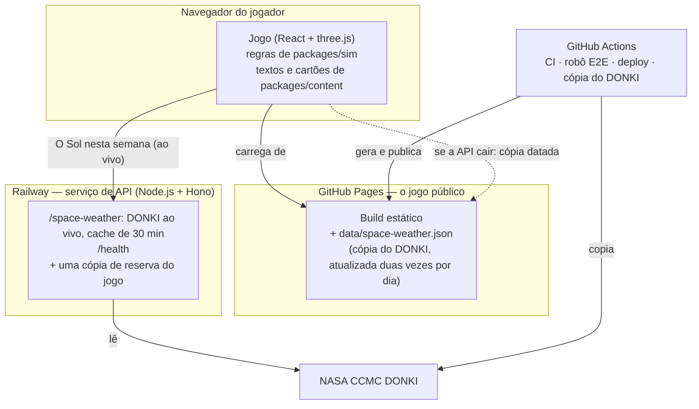

- **O GitHub Pages é o endereço público do jogo:** https://rafaelafeijo.github.io/mars-to-go/. Ele é gerado de novo a cada push na `main` e duas vezes por dia, para atualizar a cópia datada do DONKI ([`pages.yml`](.github/workflows/pages.yml)).
- **O Railway roda o nosso serviço de API** (Node.js + Hono, [`apps/api`](apps/api)): ele lê o NASA DONKI ao vivo para o "O Sol nesta semana" (com cache de 30 minutos, sem precisar de chave de API) e responde a uma verificação de saúde. Ele também mantém uma **cópia de reserva** do jogo. É apoio de infraestrutura: o jogo em si roda inteiro a partir do GitHub Pages, e, se a API não responder, a tela inicial passa a usar a cópia datada.
- **As regras são puras e separadas.** O `packages/sim` não tem interface nem código de rede; as mesmas funções rodam a prévia durante o planejamento, a noite, a projeção e os testes.

```
apps/web          o jogo: React + Vite + three.js (@react-three/fiber)
apps/api          serviço de API: Hono; /health, /space-weather (DONKI com cache), cópia do jogo
packages/sim      regras puras do jogo, testes primeiro; science.ts guarda cada constante com a sua fonte
packages/content  textos em en e pt-BR, catálogo de eventos, cartões de dados, fatos da NASA
packages/ui       tokens de design
tools/data        scripts Python de imagens e dados
scripts           robô que joga de ponta a ponta (Playwright)
docs/en, docs/pt-BR   documentação nos dois idiomas; docs/media guarda as imagens do README
```

Mais: [`docs/pt-BR/ARCHITECTURE.md`](docs/pt-BR/ARCHITECTURE.md).

---

## 10. Qualidade: testes, segurança, desempenho

- **72 testes automáticos:** 58 para as regras da simulação (motor, projeção, carreira, ciência), 11 para o conteúdo (todo cartão bate com o `science.ts`; toda chave de texto existe nos dois idiomas) e 3 para a API. Rode com `pnpm test`; verificação de tipos, lint e testes juntos com `pnpm check`, a cada push ([`ci.yml`](.github/workflows/ci.yml)).
- **Um robô joga o jogo a cada push:** o [`scripts/playthrough.mjs`](scripts/playthrough.mjs) gera o jogo e joga a missão 1 em inglês e em português e nas três interfaces, e a missão 2 até o fim, numa tela do tamanho de um celular e numa do tamanho de um computador. Ele falha se a tripulação não voltar para casa ([`e2e.yml`](.github/workflows/e2e.yml)); as capturas de tela deste README vêm dele e de uma gravação com GPU do mesmo jogo.
- **Segurança:**
  - Uma Content Security Policy rígida no jogo publicado: scripts só do próprio jogo, rede só para o jogo e para o nosso serviço de API.
  - Nenhum referenciador (referrer) é enviado.
  - Nenhum decodificador 3D é baixado de uma CDN.
  - O robô falha em qualquer pedido a terceiros ou em qualquer violação da Content Security Policy.
  - Nenhum segredo no repositório, e nenhum source map publicado.
- **Desempenho:** cerca de 0,7 MB são transferidos até chegar ao primeiro sol, medido pelo robô; modelos low-poly e uma fonte hospedada com o jogo.

---

## 11. Acessibilidade, idiomas e privacidade

- **Fácil de ler:** Atkinson Hyperlegible Next, uma fonte feita para a legibilidade, com frases curtas e cada termo científico explicado em uma frase onde aparece.
- **Toque e teclado:** áreas de toque de pelo menos 44 px; tudo o que se faz no 3D também pode ser feito pela barra de baixo, pelo teclado ou com um leitor de tela.
- **Nunca só pela cor:** ícones e palavras acompanham cada cor.
- **Calmo por padrão:** o movimento reduzido é respeitado, e o nível Cadete dá 30 segundos numa crise, em vez de 10.
- **Dois idiomas, completos:** inglês e português; um teste falha se faltar uma chave de texto em qualquer um deles.
- **Privacidade:** sem contas, sem analytics, sem cookies, sem dados pessoais. A fonte é hospedada com o jogo. A escolha de idioma fica no aparelho.
- **Ainda não feito:** uma auditoria completa de WCAG 2.2 AA.

---

## 12. Como rodar localmente

Requisitos: Node 22 e pnpm (via `corepack enable`).

```bash
pnpm install
pnpm dev          # jogo em http://localhost:5173
pnpm dev:api      # API em http://localhost:8787 (/health, /space-weather)
pnpm check        # typecheck + lint + testes
pnpm build
node scripts/playthrough.mjs out en world   # joga as missões 1 e 2 de ponta a ponta (Playwright)
```

Não é preciso chave de API: o DONKI é lido em `ccmc.gsfc.nasa.gov` sem chave.

---

## 13. Uso de IA

- **O jogo:** nenhuma mídia gerada por IA. Toda foto é uma imagem real da NASA; os modelos 3D são da Kenney (CC0); o astronauta, os ícones e o terreno são desenhados em código.
- **Só o vídeo de demonstração:** a narração foi gerada com o **Kokoro-82M**, uma ferramenta de IA de código aberto que transforma texto em fala (Apache-2.0). Ela não imita nenhuma pessoa real, e isso está dito na tela, na descrição do YouTube e nos metadados do arquivo. Todo o resto do vídeo é real: fotos da NASA e imagens gravadas do jogo.
- **Código e documentação:** escritos com o **Claude Code** (Anthropic), sob a direção e a revisão do time; o Claude Code também foi usado para encontrar, ler e conferir as fontes da NASA. A ideia do jogo, as decisões de design, os testes com a criança e todas as revisões são do time.

Detalhes: [`docs/pt-BR/AI_USAGE.md`](docs/pt-BR/AI_USAGE.md).

---

## 14. Créditos e licenças

- **NASA:** NASA, NASA/JPL-Caltech, CCMC (DONKI) e as instituições parceiras creditadas em cada imagem, com fonte, crédito e licença em [`docs/pt-BR/ASSETS.md`](docs/pt-BR/ASSETS.md).
- **Modelos 3D:** Kenney Space Kit e Space Station Kit (CC0).
- **Fonte:** Atkinson Hyperlegible Next, Braille Institute (SIL OFL 1.1).
- **Vídeo de demonstração:**
  - Narração: Kokoro-82M (Apache-2.0).
  - Música: "Space", de leberch (Pixabay Content License).
  - Imagens: AS17-152-23311, AS08-14-2383, AS15-88-11901, PIA23645, PIA24921 (NASA, NASA/JPL-Caltech, ASU, MSSS).

Este projeto não tem vínculo com a NASA nem o endosso dela. Não usamos logotipos, insígnias nem identificadores de missão da NASA.

**Licença:** código sob [MIT](LICENSE). Os dados e as imagens da NASA seguem os seus próprios termos (veja [ASSETS](docs/pt-BR/ASSETS.md)).

---

## 15. Limitações e próximos passos

**O que é simplificado (e o jogo diz isso):**
- Uma célula de energia não é uma unidade real de energia, e os pontos de risco e de dose não são doses reais.
- Uma CME chega na mesma noite no jogo, enquanto as reais levam dias.
- A missão 2 reorganiza registros reais de uma semana em sete sóis.
- O terreno 3D é uma ilustração inspirada em Jezero, não um mapa.

**O que ainda não foi construído:**
- A missão 3 ("Céu de poeira"), o "Me surpreenda" e o "Hoje no espaço" (eventos ao vivo dentro de uma missão).
- Salvar o progresso com um código de carreira; as regras existem em [`code.ts`](packages/sim/src/code.ts), mas o app salva só o idioma.
- Um modo para a sala de aula, uma página "a ciência por trás" com um JSON público de todos os cartões e uma auditoria completa de WCAG 2.2 AA.

**O que mediríamos em seguida:** se as crianças conseguem explicar a troca com as próprias palavras depois de jogar. Até agora, a nossa única evidência é um testador, de 8 anos.
