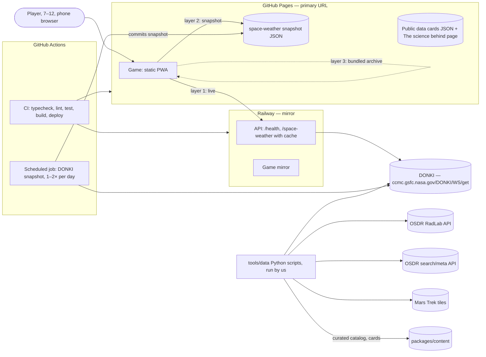
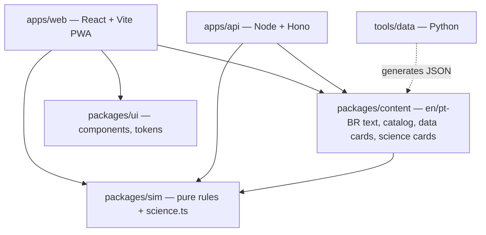
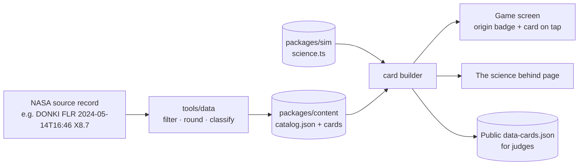
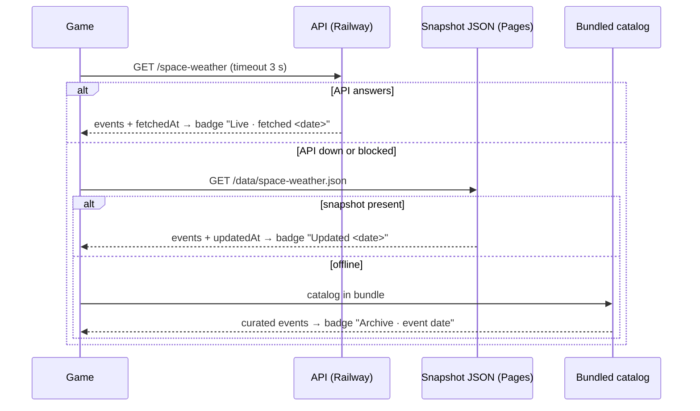
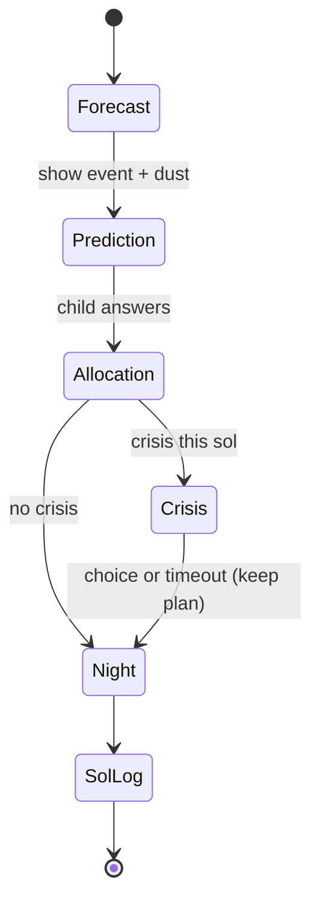
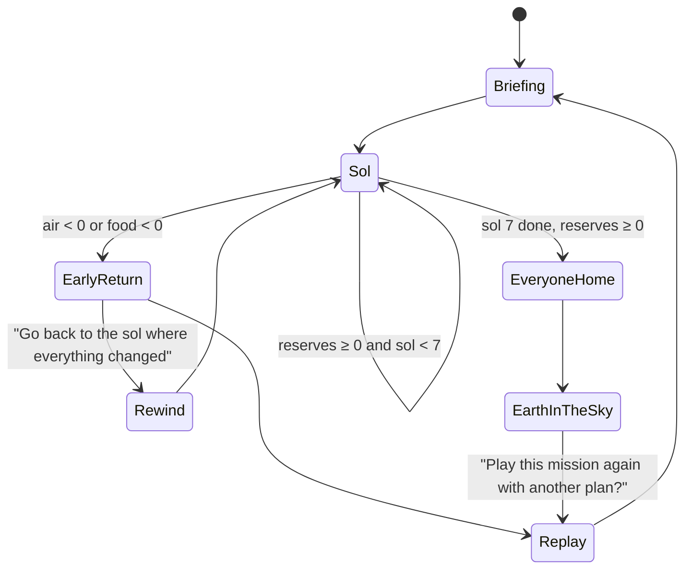

# Architecture — Mars to Go

> Status: **approved 2026-11-14 (Phase 0)**; career code, scenes and visual direction updated the same day (ADR-0019 to ADR-0024). Diagrams are Mermaid (GitHub renders them).
> Portuguese version: [`docs/pt-BR/ARCHITECTURE.md`](../pt-BR/ARCHITECTURE.md).

## 1. Context



What the probes (Phase 0.2) decided:
- **DONKI** answers at `https://ccmc.gsfc.nasa.gov/DONKI/WS/get/{FLR|CME|CMEAnalysis|SEP|GST|WSAEnlilSimulations|notifications}`, no key, `Access-Control-Allow-Origin: *`. The old host `kauai.ccmc.gsfc.nasa.gov` timed out; `api.nasa.gov/DONKI/FLR` returned 404 while CME/SEP/GST/notifications returned 200. → The API and the cron use the `ccmc.gsfc.nasa.gov` host; no NASA key needed for DONKI.
- **RadLab** answers CSV/JSON with **no CORS header** → never called from the browser; only by `tools/data` (and optionally the API).
- **OSDR** search/meta answer JSON with CORS restricted to `osdr.nasa.gov` → build-time only.
- **Mars Trek** tiles for the Jezero CTX mosaic are public (`Access-Control-Allow-Origin: *`), but the game ships a static, credited capture (no tile client in the MVP).

## 2. Monorepo modules



Rules:
- `packages/sim` imports nothing from the others (ADR-0009). It owns `science.ts`: every constant with value, unit, label, source, URL, place, access date.
- `packages/content` owns every UI string (en default, pt-BR) and every data card. Data cards reference constants by ID from `science.ts`, so a card and the number it explains cannot drift.
- `apps/web` and `apps/api` only display or deliver what `sim` and `content` produce.
- API framework proposal: **Hono** on Node (small, TypeScript-first). Alternative: Fastify.

## 3. Data flow (one source of truth)



All three outputs (screen, page, public JSON) are built from the same `card builder` at build time. A data point whose card is incomplete or marked pending is **hidden from every screen** and listed in a build report; it does not fail the build or the deploy (rule 16: no card, no screen — ADR-0024).

## 4. Space weather in three layers



- The **mission** always draws its events from the curated catalog (8–12 real events), so a calm Sun still gives a playable mission. Live and snapshot data feed **"Today in space"**; a recent event with a Mars arrival can enter the mission, carrying its own badge.
- API cache: in memory, 30 min TTL; on DONKI failure, serve last good response with its original `fetchedAt` (never relabeled as fresh).
- Snapshot job: GitHub Actions cron, writes `apps/web/public/data/space-weather.json` with `updatedAt`, commits only when content changed.

## 5. State machines

### A sol



### A mission



## 6. What is saved on the device

```ts
// localStorage key "mars-to-go:save"
type Save = {
  saveVersion: 1;           // bump + migrate on breaking change
  locale: 'en' | 'pt-BR';
  settings: { assisted: boolean; reducedMotion: boolean; highContrast: boolean; sound: boolean };
  career: {
    unlocked: MissionId[];        // 'm1' | 'm2' | 'm3' | 'surprise' | 'today'
    badges: { missionId: MissionId; verdict: string; stripes: string[] }[];
    discoveries: string[];        // science card IDs, across missions
    seenSolCaption: boolean;      // "day N on Mars" caption shown once (SIM_MODEL §12)
  };
  mission: MissionState | null;   // from SIM_MODEL §3
  checkpoints: MissionState[];    // start of each sol, enables "go back to sol N"
  avatar?: { suitColor: string; emblem: string; codename: string }; // from fixed lists only
};
```

No name, no free text, no personal data. "Erase progress" clears the key. Settings warn that, without the career code, clearing the browser's data erases progress.

### Career code (ADR-0022)

A short code that restores the whole career on another device: `codeVersion · unlocked missions (bits) · badges (verdict + stripes per mission) · discoveries (bits) · mission in progress (missionId · seed · sol · air · food · exposure · pending harvests)`. Packed into bits, written in Crockford base32 (no I/L/O/U), grouped in blocks of 4 with a check character — about 20–24 characters (with a mission in progress; fewer without). It holds only game numbers. Checkpoints are not in the code; after a restore, "go back to sol N" is available from the restored sol onwards.

## 7. Screen map (mobile first, 360 px portrait)

Twelve moments, each with its own transition, grouped into **six scenes** that reuse the same backdrop and components (ADR-0023 for the visual direction). The world is vector illustration made in code; a real photo appears full and highlighted only in "this is real" moments, always with the "REAL PHOTO" badge, credit, mission and date.

| Scene | Moments | What it shows | Data cards on it |
| --- | --- | --- | --- |
| **Morning** (base by day) | Forecast · Prediction question · Allocation | Event of the sol and tomorrow's "maybe"; dust; the question; 10 cells (3 locked for heating), open destinations (padlocks in mission 1), the live open math | DONKI event; event→risk table; dust; cells per sol; heating; each destination's rule; MOXIE; greenhouse delay |
| **Crisis** (same base, alert light) | Crisis | 10 s clock (paused in assisted mode), 2–3 options with cost, "Ask Earth" disabled with "at least 8 minutes" | Event card; radio delay |
| **Night** (base at dusk → night) | Night math · Sol log | Steps animated one by one (optional pick-the-result); prediction vs result, Earth's answer with signal time, "what if" | Every number shown |
| **Outside the base** | Expedition map · Ask Earth | Jezero from above with the base and 3 real sites (only sourced distances, e.g. delta 2.3 km); question list about tomorrow | Mars Trek capture; site photos (real); radio delay |
| **End** | Verdict · Earth in the sky · Play again | Verdict, margin in sols of reserve, exposure word, discoveries, badge; Earth as a dot of light (real photo); replay / go back to the sol | Earth-from-Mars photo; verdict rules |
| **Support** | Opening · Home with the career · The science behind · Settings | Opening (skippable); home: text logo, "Play" (career), "How it works", "Surprise me", rotating role word, honest footer; all cards filterable by label and place; settings (language PT/EN, assisted mode, contrast, motion, sound, erase progress, career code) | Opening facts (sol, EDL); all cards |

Avatar comes last (ADR-0018).
