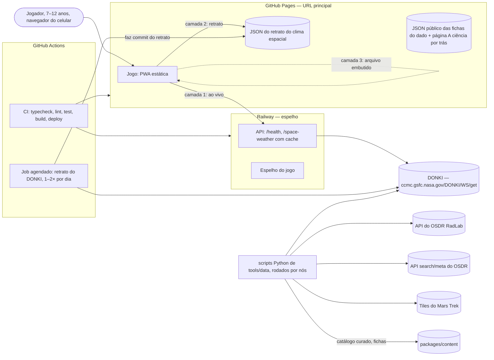
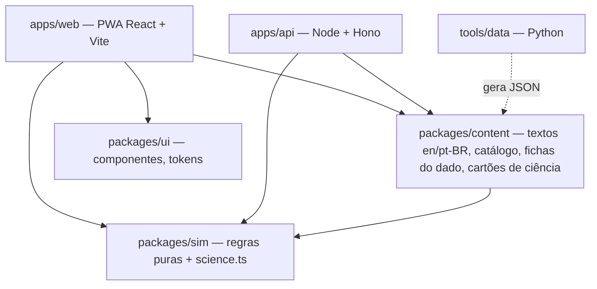
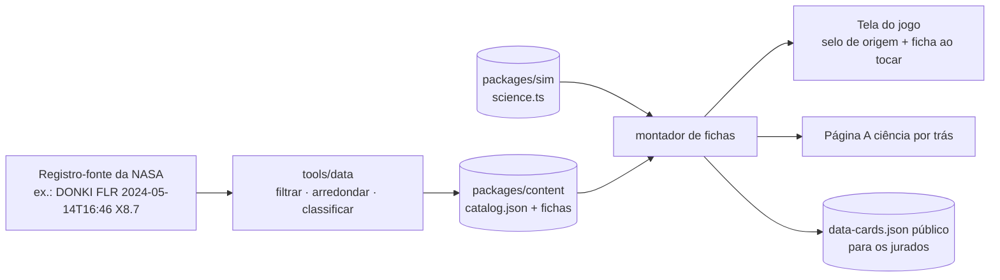
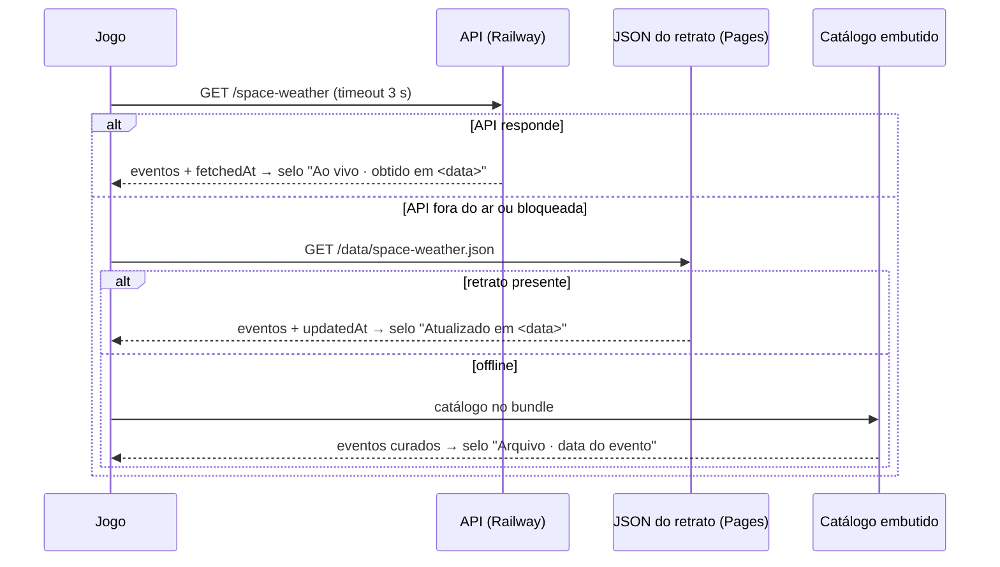
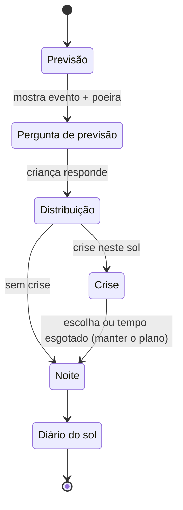
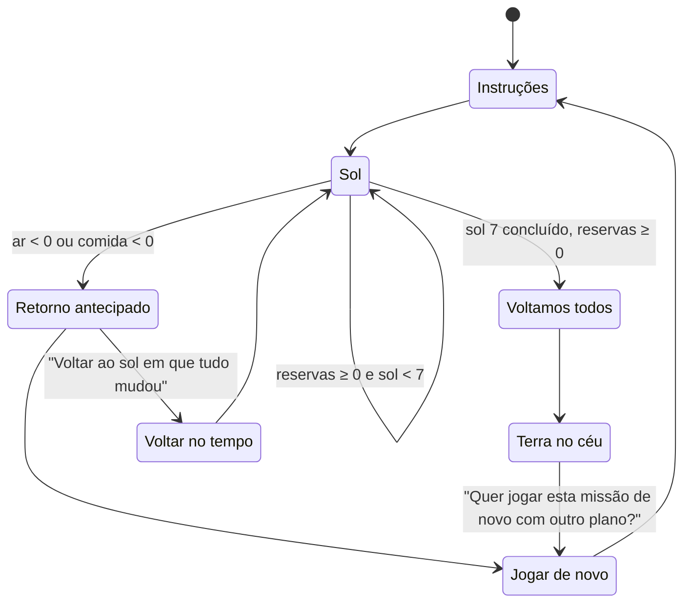

# Arquitetura — Mars to Go

> Status: **aprovada em 2026-11-14 (Fase 0)**; código da carreira, cenas e direção visual atualizados no mesmo dia (ADR-0019 a ADR-0024). Os diagramas são em Mermaid (o GitHub renderiza).
> Versão em inglês (padrão): [`docs/en/ARCHITECTURE.md`](../en/ARCHITECTURE.md).

## 1. Contexto



O que as sondagens (Fase 0.2) decidiram:
- O **DONKI** responde em `https://ccmc.gsfc.nasa.gov/DONKI/WS/get/{FLR|CME|CMEAnalysis|SEP|GST|WSAEnlilSimulations|notifications}`, sem chave, com `Access-Control-Allow-Origin: *`. O host antigo `kauai.ccmc.gsfc.nasa.gov` estourou o tempo limite; `api.nasa.gov/DONKI/FLR` devolveu 404, enquanto CME/SEP/GST/notifications devolveram 200. → A API e o cron usam o host `ccmc.gsfc.nasa.gov`; não é preciso chave da NASA para o DONKI.
- O **RadLab** responde CSV/JSON **sem cabeçalho CORS** → nunca é chamado pelo navegador; só pelo `tools/data` (e, opcionalmente, pela API).
- O search/meta do **OSDR** responde JSON com CORS restrito a `osdr.nasa.gov` → só em tempo de build.
- Os tiles do **Mars Trek** para o mosaico CTX de Jezero são públicos (`Access-Control-Allow-Origin: *`), mas o jogo inclui uma captura estática e creditada (sem cliente de tiles no MVP).

## 2. Módulos do monorepo



Regras:
- `packages/sim` não importa nada dos outros (ADR-0009). Ele é dono do `science.ts`: cada constante com valor, unidade, rótulo, fonte, URL, local e data de acesso.
- `packages/content` é dono de todo texto da interface (en padrão, pt-BR) e de toda ficha do dado. As fichas do dado referenciam constantes do `science.ts` pelo ID, então uma ficha e o número que ela explica não podem se desencontrar.
- `apps/web` e `apps/api` só exibem ou entregam o que `sim` e `content` produzem.
- Proposta de framework para a API: **Hono** sobre Node (pequeno, pensado para TypeScript). Alternativa: Fastify.

## 3. Fluxo de dados (uma única fonte da verdade)



As três saídas (tela, página, JSON público) são construídas pelo mesmo `card builder` em tempo de build. Um dado cuja ficha está incompleta ou marcada como pendente fica **escondido de todas as telas** e listado em um relatório do build; ele não faz o build nem o deploy falharem (regra 16: sem ficha, sem tela — ADR-0024).

## 4. Clima espacial em três camadas



- A **missão** sempre tira seus eventos do catálogo curado (8–12 eventos reais), então um Sol calmo ainda rende uma missão jogável. Os dados ao vivo e do retrato alimentam o **"Hoje no espaço"**; um evento recente com chegada a Marte pode entrar na missão, levando seu próprio selo.
- Cache da API: em memória, TTL de 30 min; se o DONKI falhar, serve a última resposta boa com seu `fetchedAt` original (nunca rotulada de novo como recente).
- Job do retrato: cron do GitHub Actions, grava `apps/web/public/data/space-weather.json` com `updatedAt` e só faz commit quando o conteúdo mudou.

## 5. Máquinas de estado

### Um sol



### Uma missão



## 6. O que é salvo no aparelho

```ts
// localStorage key "mars-to-go:save"
type Save = {
  saveVersion: 1;           // bump + migrate on breaking change
  locale: 'en' | 'pt-BR';
  settings: { assisted: boolean; reducedMotion: boolean; highContrast: boolean; sound: boolean };
  career: {
    unlocked: MissionId[];        // 'm1' | 'm2' | 'm3' | 'surprise' | 'today'
    badges: { missionId: MissionId; verdict: string; stripes: string[] }[];
    discoveries: string[];        // science card IDs, across missions
    seenSolCaption: boolean;      // "day N on Mars" caption shown once (SIM_MODEL §12)
  };
  mission: MissionState | null;   // from SIM_MODEL §3
  checkpoints: MissionState[];    // start of each sol, enables "go back to sol N"
  avatar?: { suitColor: string; emblem: string; codename: string }; // from fixed lists only
};
```

Nenhum nome, nenhum texto livre, nenhum dado pessoal. "Apagar progresso" limpa a chave. As configurações avisam que, sem o código da carreira, limpar os dados do navegador apaga o progresso.

### Código da carreira (ADR-0022)

Um código curto que restaura a carreira inteira em outro aparelho: `codeVersion · unlocked missions (bits) · badges (verdict + stripes per mission) · discoveries (bits) · mission in progress (missionId · seed · sol · air · food · exposure · pending harvests)`. Compactado em bits, escrito em base32 de Crockford (sem I/L/O/U), agrupado em blocos de 4 com um caractere de verificação — cerca de 20–24 caracteres (com missão em andamento; menos sem ela). Ele guarda só números do jogo. Os checkpoints não estão no código; depois de uma restauração, "voltar ao sol N" fica disponível do sol restaurado em diante.

## 7. Mapa de telas (mobile first, 360 px em retrato)

Doze momentos, cada um com sua própria transição, agrupados em **seis cenas** que reaproveitam o mesmo cenário de fundo e os mesmos componentes (ADR-0023 para a direção visual). O mundo é ilustração vetorial feita em código; uma foto real aparece inteira e em destaque só nos momentos de "isto é real", sempre com o selo "FOTO REAL", crédito, missão e data.

| Cena | Momentos | O que mostra | Fichas do dado nela |
| --- | --- | --- | --- |
| **Manhã** (base de dia) | Previsão · Pergunta de previsão · Distribuição | Evento do sol e o "talvez" de amanhã; poeira; a pergunta; 10 células (3 travadas para o aquecimento), destinos abertos (cadeados na missão 1), a conta aberta ao vivo | Evento do DONKI; tabela evento→risco; poeira; células por sol; aquecimento; a regra de cada destino; MOXIE; atraso da estufa |
| **Crise** (mesma base, luz de alerta) | Crise | Relógio de 10 s (pausado no modo assistido), 2–3 opções com custo, "Perguntar à Terra" desativado com "pelo menos 8 minutos" | Ficha do evento; atraso do rádio |
| **Noite** (base ao entardecer → noite) | Conta da noite · Diário do sol | Passos animados um por um (escolha opcional do resultado); previsão vs. resultado, resposta da Terra com o tempo do sinal, "e se" | Todo número mostrado |
| **Fora da base** | Mapa da expedição · Perguntar à Terra | Jezero vista de cima com a base e 3 locais reais (só distâncias com fonte, por exemplo delta a 2,3 km); lista de perguntas sobre amanhã | Captura do Mars Trek; fotos dos locais (reais); atraso do rádio |
| **Fim** | Veredito · Terra no céu · Jogar de novo | Veredito, margem em sóis de reserva, palavra da exposição, descobertas, insígnia; a Terra como um ponto de luz (foto real); jogar de novo / voltar ao sol | Foto da Terra vista de Marte; regras do veredito |
| **Apoio** | Abertura · Início com a carreira · A ciência por trás · Configurações | Abertura (pulável); início: logo em texto, "Jogar" (carreira), "Como funciona", "Me surpreenda", palavra de papel que se alterna, rodapé honesto; todas as fichas filtráveis por rótulo e local; configurações (idioma PT/EN, modo assistido, contraste, movimento, som, apagar progresso, código da carreira) | Fatos da abertura (sol, EDL); todas as fichas |

O avatar vem por último (ADR-0018).
